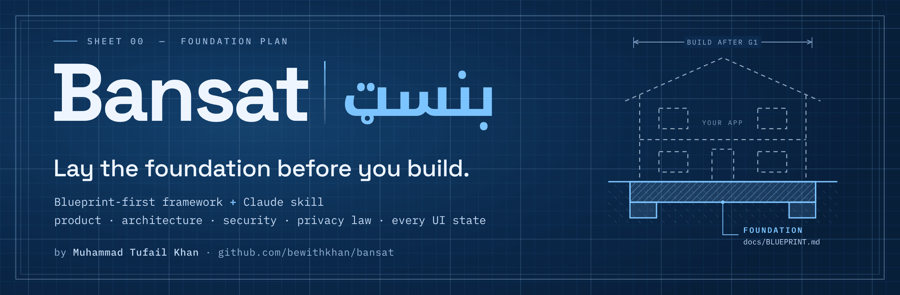
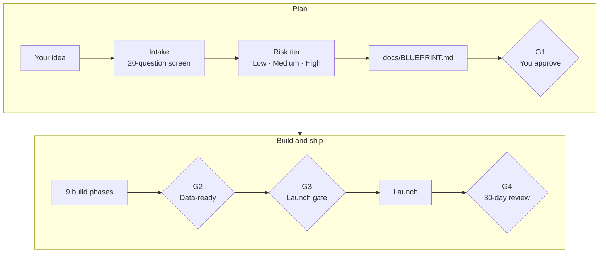
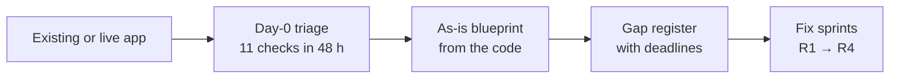

<p align="center">
  
</p>

<h3 align="center">Your AI can build an app in a weekend.<br>Bansat makes sure it's one you can actually launch.</h3>

<p align="center">
  A blueprint-first framework and <a href="https://agentskills.io">Agent Skill</a> for Claude. Before any production code, your AI agent writes the plan a senior team would: product, architecture, security, privacy law, accessibility and every UI state. Then it stops and waits for your approval.
</p>

<p align="center">
  <a href="https://agentskills.io"></a>
  
  <a href="https://github.com/bewithkhan/bansat/actions/workflows/validate.yml"></a>
  
  
  <a href="#licence"></a>
</p>

<p align="center">
  <a href="https://bewithkhan.github.io/bansat/"><b>Read it online</b></a> ·
  <a href="#install-in-60-seconds"><b>Install</b></a> ·
  <a href="#see-it-work"><b>See it work</b></a> ·
  <a href="#the-17-launch-traps"><b>17 launch traps</b></a> ·
  <a href="#real-breaches-and-the-checks-that-catch-them"><b>Breach casebook</b></a> ·
  <a href="#whats-in-the-blueprint"><b>What's inside</b></a> ·
  <a href="#cite"><b>Cite</b></a>
</p>

---

## The bugs that sink AI-built apps aren't in the code

They're decisions nobody made. The demo works and the tests pass. Then:

- **Row Level Security is off**, so anyone with your app's public key can read or change your tables.
- **Your fonts load from Google**, handing every visitor's IP address to a third party before consent. A Munich court awarded damages for exactly this in 2022.
- **Hotjar or Clarity start recording** before anyone has said yes.
- **The "we launched!" email** goes to your waitlist with no unsubscribe link, no sender identity and no address.
- **The sign-up form never asks for age**, so you may be holding children's data without parental consent. Under Nigeria's NDPA, a child is anyone under 18.
- **The privacy policy was written by an AI** and describes an app that doesn't exist.

Bansat makes every one of those decisions explicit before the first commit, and checks them again before launch.

> *Bansat* (بنسټ) is Pashto for "foundation": the part you lay before you build.

## How it works



The gates are the point. At each one, Claude is instructed to stop and wait for you:

- **G1:** no production code until you approve the blueprint.
- **G2:** no real personal data, not even a waitlist email, until the privacy basics are live: the notice, processing records, consent capture, processor contracts, access-isolation tests and the ICO fee.
- **G3:** no launch while any of the 18 blocking checks is red.

A skill can only instruct Claude, not force it. For a hard stop at G1, add the [optional G1 hook](#make-g1-a-hard-stop-optional): it refuses Claude's code edits until a person signs the blueprint.

**Already built something?** The retrofit track triages the live risks within 48 hours, reverse-engineers the blueprint from your code, and turns every gap into a fix with a deadline:



## Install in 60 seconds

**Claude Code** (terminal or VS Code). Install it once and use it in every project. Installs are pinned to a release, so the skill's instructions never change without you choosing to update:

```bash
# macOS / Linux
git clone --branch v2.4.0 --depth 1 https://github.com/bewithkhan/bansat ~/.claude/skills/bansat
```

```powershell
# Windows (PowerShell)
git clone --branch v2.4.0 --depth 1 https://github.com/bewithkhan/bansat "$HOME\.claude\skills\bansat"
```

Start a new Claude Code session and type `/bansat`. To share it with your team, copy the folder into your repo at `.claude/skills/bansat/` and commit it.

**Updating:** read the [changelog](CHANGELOG.md), then switch the folder to the release you want (replace `vX.Y.Z`; on Windows, use `"$HOME\.claude\skills\bansat"` as the path):

```bash
git -C ~/.claude/skills/bansat fetch --depth 1 origin tag vX.Y.Z
git -C ~/.claude/skills/bansat checkout vX.Y.Z
```

**Claude apps** (web and desktop): add it as a skill in your Claude settings. See [Use skills in Claude](https://support.claude.com/en/articles/12512180-use-skills-in-claude).

**Any other agent:** `SKILL.md` follows the open [Agent Skills](https://agentskills.io) format, so skills-compatible agents can load it as it is. For Cursor, Copilot, Lovable, Bolt or anything else that reads a rules file, give the agent `reference/bansat-framework.md` (or only the modules it needs from [`framework/`](framework/README.md)) and paste its [Part 12.1 agent rules](reference/bansat-framework.md#p12) into `AGENTS.md`, `.cursor/rules` or your project knowledge.

### Make G1 a hard stop (optional)

The skill tells Claude to stop at G1, but an agent can still skip a step. This Claude Code hook makes it a hard stop in a new project. Until a person signs the G1 row in `docs/BLUEPRINT.md`, Claude's file edits outside `docs/`, `spikes/` and `.claude/` are refused, and Claude can't sign the row itself. It needs Node.js 18 or later.

1. Copy the hook into the project:
   ```bash
   mkdir -p .claude/hooks && cp ~/.claude/skills/bansat/hooks/bansat-g1-guard.mjs .claude/hooks/
   ```
   On Windows (PowerShell): `New-Item -ItemType Directory -Force .claude\hooks; Copy-Item "$HOME\.claude\skills\bansat\hooks\bansat-g1-guard.mjs" .claude\hooks\`
2. Add this to the project's `.claude/settings.json`, merged with any hooks you already have:
   ```json
   {
     "hooks": {
       "PreToolUse": [
         {
           "matcher": "Write|Edit|MultiEdit|NotebookEdit",
           "hooks": [
             {
               "type": "command",
               "command": "node",
               "args": ["${CLAUDE_PROJECT_DIR}/.claude/hooks/bansat-g1-guard.mjs"]
             }
           ]
         }
       ]
     }
   }
   ```
3. When you approve the blueprint, fill in the G1 row yourself, for example `| G1 Blueprint approved | Your Name | 2026-11-05 | |`.

The hook guards Claude's file-editing tools, not shell commands, so treat it as a guard rail rather than a sandbox. Its tests run with `node hooks/bansat-g1-guard.test.mjs`.

## See it work

In Claude Code, in an empty folder:

```text
/bansat I want to build a revision app with an AI tutor for students in the UK and Nigeria
```

Bansat restates the idea and asks at most five questions, only where a wrong guess would be costly. It then writes `docs/BLUEPRINT.md` and a summary like this one (abridged):

```text
Risk tier       HIGH: under-18s are a likely audience, plus AI features
DPIA            Required before any real data
Stack profile   D2 Progressive web app
Modules         Part 8 AI · 9.11 Marketing · 9.12 Children

Top 5 risks
 1  Children's data. The UK Children's Code is likely to apply, and Nigeria's
    NDPA treats anyone under 18 as a child: parental consent if you rely on
    consent, plus an age check.
 2  Student work sent to an LLM. Needs a DPA, no training on your data,
    redaction and a clear notice.
 3  The waitlist launch email. Needs consent evidence, one-click unsubscribe
    and sender details.
 4  Nigerian users. Past 200 in any six months you're a data controller of
    major importance and must register with the NDPC.
 5  AI cost abuse. Per-user quotas, a spend cap and a rate-limit screen (S13).

Assumptions     Web first · a waitlist before launch · no payments in the MVP
                13+ with a parental-consent flow                    (all flagged)
Open question   Will schools sign pupils up? Then you're their processor.
Missing for G1  Legal entity · ICO fee tier · AI provider

No production code until you approve this blueprint (G1).
```

Auditing an existing app works the same way: run `/bansat audit this repo`. The Day-0 triage comes first, marking each check pass, fail or unknown with its evidence: exposed secrets, missing RLS, public buckets, tracking before consent, unsafe marketing email, children's data, credentials AI agents and CI can reach, and whether anything was actually exposed.

## The 17 launch traps

These are the failures that get vibe-coded apps fined, breached or rejected by the app stores. Bansat checks every one before you collect real data (G2), and again before launch (G3). The full table, with fixes and tests, is in [§9.26 of the framework](reference/bansat-framework.md#926-launch-trap-audit-the-vibe-coding-failures-that-get-apps-fined).

| # | Trap | Why it bites |
|---|---|---|
| 1 | The sign-up form never asks for age | Children's data without parental consent or safeguards. Under Nigeria's NDPA, a child is anyone under 18. |
| 2 | Fonts from `fonts.googleapis.com` or any CDN | Visitor IP addresses go to a third party with no lawful basis. German courts have awarded damages. |
| 3 | Session replay or heatmaps load before consent | A consent breach, and recordings can capture personal data |
| 4 | A "we launched" email with no unsubscribe, sender identity or address | Breaches UK PECR, US CAN-SPAM and the NDPA, and fails Gmail and Yahoo sender rules |
| 5 | RLS off (or unscoped queries), or the secret key in the client | Anyone can read or write your database: a breach, with 72-hour deadlines |
| 6 | A template or AI-written privacy policy | It doesn't match what the app does, so it breaches transparency rules |
| 7 | Ad or analytics pixels in the root layout | Data shared with ad platforms before consent |
| 8 | User data sent to an LLM with no disclosure or DPA | Transparency, transfer and contract breaches, and possible training on your data |
| 9 | No way to delete an account or export data | A rights breach, and an App Store rejection |
| 10 | Personal data in logs or error trackers | Breaches minimisation and widens any breach |
| 11 | Pre-ticked boxes, or "by using this site you agree" | Invalid consent |
| 12 | A cookie banner with no "Reject all" | Invalid consent, and a top enforcement theme for regulators |
| 13 | Real customer data in preview or staging | A security and purpose-limitation breach |
| 14 | A public storage bucket for user uploads | Data exposure |
| 15 | ICO fee unpaid; NDPC status unchecked | ICO penalties of up to £4,350; missed duties for Nigeria's major-importance controllers |
| 16 | No breach plan | Missed 72-hour clocks |
| 17 | Dates of birth or ID scans kept "just in case" | A minimisation breach, and a honeypot for attackers |

> If you read one thing in this repo, read this table. Then check your own app against it.

## Real breaches, and the checks that catch them

The [breach casebook](framework/appendix-f-casebook.md) (Appendix F, also [online](https://bewithkhan.github.io/bansat/casebook/)) maps 20 documented incidents and regulators' decisions from 2025 and 2026 to the Bansat checks that catch each class of failure. Every case rests on a primary source: the organisation's own statement, a regulator's decision, a CVE record or the researcher who found the problem.

| Case | What happened, as reported | The check for this class of failure |
|---|---|---|
| Lovable-built apps (CVE-2025-48757) | 303 endpoints in 170 of 1,645 showcased apps let visitors read database tables | RLS on every table, with isolation tests in CI (5.4) |
| A scan of Supabase apps | 16,326 databases had tables anyone could read | Day-0 triage T2 lists every table without RLS (14.2) |
| Replit and SaaStr | An AI agent deleted a production database during a code freeze | Separate environments and keys (3.2); agents hold no production credentials (12.1) |
| "Agentjacking" | Fake error reports led AI coding agents to run outsiders' code (a research demonstration) | Text the agent reads in tool results, issues and error reports is data, not instructions (12.1) |
| Shai-Hulud | A worm spread through more than 500 npm packages, stealing tokens | Hardened CI/CD and publishing, and new versions left to age (7.4) |
| Mixpanel and OpenAI | An analytics vendor's breach exposed API users' names and email addresses | Analytics get IDs, never names or emails (5.1) |
| ICO: 23andMe, £2.31m | Credential stuffing, no mandatory MFA, and a claim of stolen data dismissed as a hoax | Passkeys or MFA for accounts that can see special category data (9.13); breached-password checks (7.1); credible claims start the breach runbook (9.20) |
| CNIL: SHEIN, €150m | Advertising cookies before any choice, and after "Refuse all" | A CI test that nothing non-essential loads before consent or after rejection (9.9) |

The cases run from apps one person built with an AI tool to the largest platforms, because the same few failures turn up at every size. Mapping them also showed gaps, mostly around AI coding agents, CI/CD and connected apps, so v2.4 added 14 checks (F.9). The checks catch the class of failure; that isn't a claim that Bansat would have prevented any one incident.

## Myth vs fact

Viral compliance threads get some of this wrong. Bansat sticks to what the law actually says:

| The claim | What's actually true |
|---|---|
| "Your app can be fined ₦10m before its first sale." | ₦10m or 2% of annual gross revenue, whichever is greater, is the most the NDPC *may* impose on a major-importance controller after an investigation. It isn't automatic. The risk is still real: targeting people in Nigeria counts as operating there, and the major-importance threshold is just 200 people in six months. |
| "Hotjar and Clarity record every keystroke, including passwords." | Not by default. The real failures are missing consent, relaxed masking and unmasked custom inputs. |
| "Anyone under 18 needs parental consent." | Under Nigeria's NDPA, yes, when you rely on consent. In the UK and EU, the age for consenting to online services is between 13 and 16. Build to your markets, or make the service 18+. |

## What's in the blueprint

15 parts and 6 appendices, about 3,800 lines of Markdown, split into [modules](framework/README.md) so Claude reads only the parts each step needs. `reference/bansat-framework.md` has the whole framework in one file, and you can [read it online](https://bewithkhan.github.io/bansat/) as a searchable site with no cookies or trackers, rebuilt from this repo on every merge.

Planning with a PRD, TRD, app flow, UI/UX brief, backend schema and implementation plan? They're all here, as parts of one blueprint that can't contradict itself: the [map](framework/how-to-use.md#where-the-usual-planning-documents-live) shows where each one lives.

| Part | What it nails down |
|---|---|
| **0** Intake & risk | 20 screening questions, a risk tier, and which modules switch on |
| **1** Product (PRD) | Problem, metrics, personas, MoSCoW features with IDs, Gherkin acceptance criteria |
| **2** Non-functional | Targets with numbers: Core Web Vitals, uptime, recovery, security baseline, accessibility, cost |
| **3** Architecture (TRD) | Pinned stack, environments, a context diagram, data flows, a processor register, secrets |
| **4** Decisions (ADRs) | Baseline architecture decisions, accepted unless you override them, each recording the prior art considered |
| **5** Data | Classification, a data dictionary, an entity-relationship diagram, a Prisma 7 schema, RLS policies with isolation tests, retention |
| **6** API | An endpoint inventory, RFC 9457 errors mapped to UI states, validation, webhooks, rate limits |
| **7** Security | An authentication flow based on OWASP, an RBAC matrix, 16 pre-filled STRIDE threats, headers and CSP, logging rules |
| **8** AI features | A feature register with pinned models, data minimisation, evals, prompt-injection defences, EU AI Act labelling, spend caps |
| **9** Privacy & compliance | 27 sections, from lawful bases, consent and cookies to children, marketing, rights, breaches and DPIAs |
| **10** Experience | The app flow and a navigation map, a look-and-feel brief, WCAG 2.2 AA, contrast-checked design tokens, and 17 mandatory UI states for every screen |
| **11** Delivery | 9 phases with exit criteria, a Definition of Done, RLS, privacy and E2E tests, CI/CD, incidents, a delivery-method picker and a project-management toolkit (RACI, RAID log, status report, change requests, timeline, forecasting) |
| **12** Agent manual | Rules for `CLAUDE.md` or `AGENTS.md` (research before building), a feature protocol, an 8-step debugging protocol, and prompts for research, logic, debugging and full audits |
| **13** Launch gate | 40 go/no-go checks; any one of the 18 blocking checks stops the launch |
| **14** Retrofit | Day-0 triage, reverse-engineering, a gap register, a review cadence and a portfolio register |
| **A–F** Appendices | Templates (DPIA, LIA, breach log and more), references, a glossary, 9 stack profiles, 6 delivery-method profiles (Scrum, Kanban, stage gates, Shape Up, a solo loop and scaled methods), and a breach casebook of 20 documented incidents and regulators' decisions |

## Why not a PRD template, or just ask the AI?

| | PRD template | Asking the AI | **Bansat** |
|---|:---:|:---:|:---:|
| Product, architecture, security, privacy and UX in one plan | Product only | Patchy | ✅ |
| Gates Claude stops at until you approve | ❌ | ❌ | ✅ G0–G4, plus an optional G1 hook |
| Laws cited to the section, and checked on a stated date | ❌ | Unverified | ✅ 4 Nov 2026 |
| Code samples tested, in CI | ❌ | Untested | ✅ `examples/` |
| Looks at how others solved it before building | ❌ | Rarely | ✅ Research first |
| Fits how you run the project (Scrum, Kanban, stage gates, Shape Up, solo) | ❌ | ❌ | ✅ A picker and 6 profiles |
| A track for apps that are already live | ❌ | ❌ | ✅ Day-0 triage |
| Every UI state designed and tested on every screen | ❌ | Happy path only | ✅ 17 states |
| The same standard on every project, team and tool | Copy and paste | Per chat | ✅ One skill, one file |

## Tested, not just written

The framework's code runs in CI on every change, from the [`examples/`](examples/README.md) folder:

- The **Prisma 7 schema** creates its tables in a real Postgres database, with the connection in `prisma.config.ts` as Prisma 7 requires.
- The **RLS policies** pass 13 access checks on those tables (tenants, roles, writes, anonymous visitors), and the Day-0 audit query finds any table left without RLS.
- The **consent loader** runs in Chromium: a vendor script loads only after "Accept all", and every choice is logged.
- The **Playwright privacy test** passes on clean pages and must fail on a page that loads a third-party font before consent.
- The **TypeScript UI-state pattern** compiles in strict mode, and the build fails if a screen forgets a state.

CI also fails if a sample in the framework and its tested copy differ, so what you copy is what was tested ([issue #1](https://github.com/bewithkhan/bansat/issues/1)). Run it yourself: `cd examples && npm ci && npx playwright install chromium && npm test`. The G1 hook's tests run with `node hooks/bansat-g1-guard.test.mjs`.

<details>
<summary><b>Laws and standards covered</b> (checked 4 November 2026)</summary>

<br>

- UK GDPR and the Data Protection Act 2018, as amended by the Data (Use and Access) Act 2025
- PECR (cookies and electronic marketing), with fines now at UK GDPR levels
- The UK Children's Code (Age Appropriate Design Code)
- EU GDPR and the ePrivacy rules, including the EU representative check
- Nigeria Data Protection Act 2023 and the GAID 2025 directive
- EU AI Act: transparency duties (Art. 50), AI literacy and the high-risk check
- UK Online Safety Act 2023, for apps with user-to-user content
- UK PSTI product security rules for connectable devices, and the European Accessibility Act
- US: COPPA, CAN-SPAM, TCPA and state privacy laws
- Pointers for India, South Africa, Kenya and Pakistan
- Standards: WCAG 2.2 AA · OWASP ASVS · OWASP Top 10 for LLM Applications · STRIDE · RFC 9457 · RFC 9116 · RFC 2119

**How this was checked:** the legal sections were researched and checked against official sources (the legislation, regulator guidance and court decisions listed in Appendix B of the framework) with AI assistance, as of 4 November 2026. No lawyer has reviewed them yet. Laws change, so re-check anything you rely on before launch; see the [disclaimer](#disclaimer).

</details>

<details>
<summary><b>Works for any kind of project</b> (9 stack profiles)</summary>

<br>

| Profile | What it adds |
|---|---|
| D1 Web app (Next.js + Supabase) | The reference stack the examples use |
| D2 Progressive web app | Cache rules, offline and sync states, web push limits, and no background location on the web |
| D3 Mobile (Flutter, React Native, native) | No secrets in the binary, secure storage, store privacy labels, and Firebase rules as your RLS |
| D4 Wearables, BLE and connected devices | Device states, vendor clouds and transfers, consent from the people being monitored, PSTI |
| D5 Admin panels and CRMs | You're usually the client's processor, even when the client is abroad; exports are the biggest leak |
| D6 Research prototypes | Ethics approval, a data management plan, pseudonymisation at collection |
| D7 Websites and waitlists | A waitlist is already personal data, so the privacy basics come first |
| D8 AI agents and clinical prototypes | Synthetic data until reviewed, a medical-device check, a human in the loop |
| D9 Hardware with no personal data | Which parts apply, and when a sensor switches privacy on |

Using Laravel, Rails, Django or a database without RLS, such as MySQL? The same rules apply: access is enforced in the data layer instead, and every controller re-checks authorisation. A dedicated profile for these stacks is on the way.

</details>

## FAQ

<details>
<summary><b>Is this legal advice?</b></summary>

<br>

No. It summarises the law and regulator guidance as of 4 November 2026, cites the sections, and says when to get a qualified review: health, children, biometrics, worker monitoring or large-scale tracking. The legal sections were checked against official sources with AI assistance, and no lawyer has reviewed them yet.

</details>

<details>
<summary><b>Won't a blueprint slow me down?</b></summary>

<br>

It scales with risk. A low-risk project fills in only the essentials: intake, the core product spec, the stack, cookies and third-party requests, the launch traps, UI states and the launch gate. High-risk projects get everything, because that's where mistakes cost the most.

</details>

<details>
<summary><b>Do I need Claude?</b></summary>

<br>

No. The framework is plain Markdown that you can fill in by hand or with any AI agent. Claude Code just does the most for you: it screens your idea, writes the blueprint and stops at each gate.

</details>

<details>
<summary><b>My team already has its own process.</b></summary>

<br>

Your process wins. If your repo's `CLAUDE.md`, `AGENTS.md` or docs set out their own planning stages or templates, Bansat follows them, maps its gates onto your stages, and fills the gaps it covers best: privacy law, security and UI states.

</details>

<details>
<summary><b>My country isn't covered.</b></summary>

<br>

The engineering half applies everywhere, and the laws table has pointers for other markets. Open an issue with your country's law and a link to an official source.

</details>

<details>
<summary><b>Can I use it commercially?</b></summary>

<br>

Yes. The text and templates are CC BY 4.0, so you can use and adapt them commercially as long as you keep the credit line. The code samples are MIT.

</details>

<details>
<summary><b>How do I keep a project's blueprint current?</b></summary>

<br>

It lives in your repo as `docs/BLUEPRINT.md` and changes in the same pull request as the code. Live projects get a monthly review and a quarterly launch-trap audit.

</details>

## Cite

Use GitHub's **Cite this repository** button, or:

> Khan, M. T. (2026). *Bansat (بنسټ): A blueprint-first framework for building software* (Version 2.4) [Computer software]. GitHub. https://github.com/bewithkhan/bansat

```bibtex
@misc{khan2026bansat,
  author       = {Khan, Muhammad Tufail},
  title        = {Bansat: A blueprint-first framework for building software},
  year         = {2026},
  note         = {Version 2.4},
  howpublished = {\url{https://github.com/bewithkhan/bansat}}
}
```

## Contributing

Bansat gets better with every project it meets. Contributions are welcome:

- **A law changed?** Open an issue with a link to the official source.
- **A stack that isn't covered?** Propose a profile for Appendix D.
- **A launch trap that bit you?** Describe what happened and how you fixed it.

Keep the credit line in anything you copy or adapt (CC BY 4.0).

## Author

**Muhammad Tufail Khan**: PhD researcher in AI and IoT for healthcare at the University of the West of Scotland, based in Glasgow.

<a href="https://www.linkedin.com/in/bewithkhan/"></a>
<a href="https://github.com/bewithkhan"></a>

## Licence

- **Text and templates:** [CC BY 4.0](https://creativecommons.org/licenses/by/4.0/), full text in `LICENSE`. You can use, adapt and share them, including commercially, if you keep this credit: *"Bansat (بنسټ) by Muhammad Tufail Khan, https://github.com/bewithkhan/bansat, CC BY 4.0"*.
- **Code samples:** MIT (see `LICENSE-CODE`).
- `NOTICE` sets out which licence covers what, with the credit line.

## Disclaimer

Bansat summarises laws and regulator guidance as of 4 November 2026. It is not legal advice. The legal sections were checked against official sources with AI assistance and have not been reviewed by a lawyer. Check the current rules before you launch, and get a qualified review for high-risk processing.

---

<p align="center">
  If Bansat saves you from one bad launch, <b>star the repo</b> so the next builder finds it before theirs.<br>
  Built by Muhammad Tufail Khan · <a href="https://www.linkedin.com/in/bewithkhan/">LinkedIn</a> · <a href="https://github.com/bewithkhan">GitHub</a>
</p>
