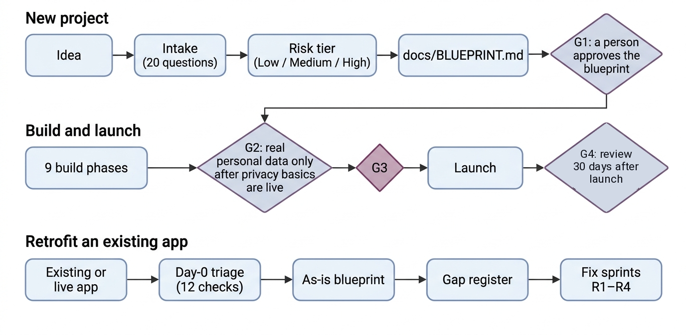

<p align="center">
  
</p>

<h3 align="center">Your AI can build an app in a weekend.<br>Bansat makes sure it's one you can actually launch.</h3>

<p align="center">
  A blueprint-first framework and <a href="https://agentskills.io">Agent Skill</a> for AI coding agents. Before any production code, your agent writes the plan a senior team would: product, architecture, security, privacy law for every market you serve, accessibility and every UI state. Then it stops and waits for your approval.
</p>

<p align="center">
  <a href="https://agentskills.io"></a>
  
  <a href="https://github.com/bewithkhan/bansat/actions/workflows/validate.yml"></a>
  <a href="#the-law-registry-and-law-watch"></a>
  <a href="#stack-profiles"></a>
  <a href="#licence"></a>
</p>

<p align="center">
  <a href="https://bewithkhan.github.io/bansat/"><b>Read it online</b></a> ·
  <a href="#install-in-60-seconds"><b>Install</b></a> ·
  <a href="#see-it-work"><b>See it work</b></a> ·
  <a href="#whats-missing-out-there-and-what-bansat-adds"><b>The gap</b></a> ·
  <a href="#the-29-launch-traps"><b>29 launch traps</b></a> ·
  <a href="#the-law-registry-and-law-watch"><b>Law registry</b></a> ·
  <a href="#stack-profiles"><b>Stack profiles</b></a> ·
  <a href="#real-breaches-and-the-checks-that-catch-them"><b>Breach casebook</b></a> ·
  <a href="#whats-in-the-blueprint"><b>What's inside</b></a> ·
  <a href="#cite"><b>Cite</b></a>
</p>

---

## The bugs that sink AI-built apps aren't in the code

They're decisions nobody made. The demo works and the tests pass. Then:

- **Row Level Security is off**, so anyone with your app's public key can read or change your tables.
- **Your fonts load from Google**, handing every visitor's IP address to a third party before consent. A Munich court awarded damages for exactly this in 2022.
- **Hotjar or Clarity start recording** before anyone has said yes.
- **The "we launched!" email** goes to your waitlist with no unsubscribe link, no sender identity and no address.
- **The sign-up form never asks for age**, so you may be holding children's data without parental consent. Under Nigeria's NDPA, a child is anyone under 18.
- **The privacy policy was written by an AI** and describes an app that doesn't exist.

Bansat makes every one of those decisions explicit before the first commit, and checks them again before launch.

> *Bansat* (بنسټ) is Pashto for "foundation": the part you lay before you build.

## What's missing out there, and what Bansat adds

AI coding agents are good at building what you ask for. The trouble is what nobody asks for. This is what we found when we looked at what builders can use today (November 2026; the sources are in the [blueprint's prior-art table](docs/BLUEPRINT.md#310-prior-art-checked-2026-11-05) and the [paper](paper/main.pdf)):

| What you need before launch | What's out there | What's missing | What Bansat adds |
|---|---|---|---|
| **A plan before the code** | Spec-driven toolkits, such as GitHub's Spec Kit, walk an agent through specify, plan, tasks and implement | The spec covers whatever you and the agent think of. Nothing makes it reach privacy law, consent, children's data, accessibility or failure states, or sizes it by risk | One 15-part blueprint, from product to launch, sized by a 20-question risk screen (Part 0) |
| **A person's sign-off** | The agent asks "shall I go ahead?" in the chat | No record of who approved what, and nothing stops the code if nobody did | Gates G1–G4 that only a person signs, recorded in the blueprint, and an optional hook that refuses code edits until G1 is signed |
| **Security decided, not just scanned** | Scanners and benchmarks find vulnerabilities in code that already exists. One benchmark found that few of the agents' working solutions were also secure, even when the request warned them | The decisions behind the code: who can read which row, which keys the agent may hold, what the user sees when something fails | Access rules with isolation tests, 16 pre-filled threats, coding-agent rules and 17 UI states for every screen, all decided before G1 (Parts 5, 7, 10, 12) |
| **The law for each market** | Law trackers such as the IAPP's and DLA Piper's are written for lawyers to read, and their terms bar using them to build software or AI tools | We found no current, structured per-country dataset that an agent can read and that cites official sources | A [registry of 120 jurisdictions](#the-law-registry-and-law-watch), every claim citing an official source (2,944 URLs), which the agent reads for the markets you name |
| **The law kept current** | Asking an AI, which can state legal falsehoods with confidence, or tracking changes by hand | A dated, reviewable record of what changed and where it's written | A weekly watch of 105 official sources: an AI drafts each update with its sources, and a person merges it |
| **Advice for your stack** | Each framework's own docs, and general security cheat sheets | The same rules (access control, secrets, consent, headers) worked out for the stack you're actually on | [24 stack profiles](#stack-profiles), from Laravel to Flutter to Bubble; the skill loads only yours |
| **A launch you can defend** | General launch checklists | Checks tied to the failures that get AI-built apps fined or breached, each with a fix and a test | The [29 launch traps](#the-29-launch-traps), checked at G2 and again at G3, and a 40-item launch gate where any of 18 blocking checks stops the launch |
| **A path for apps already live** | A full security or privacy audit | A fast first pass that finds the live risks, then a plan to close every gap | Day-0 triage within 48 hours, an as-is blueprint and a gap register with deadlines (Part 14) |

No single piece is new on its own. What's missing is all of them together, inside the agent, before the first commit. If you know a tool that already does one of these, [open an issue](https://github.com/bewithkhan/bansat/issues) and we'll link it.

## How it works

<p align="center"></p>

The gates are the point. At each one, your agent is instructed to stop and wait for you:

- **G1:** no production code until you approve the blueprint.
- **G2:** no real personal data, not even a waitlist email, until the privacy basics are live: the notice, processing records, consent capture, processor contracts, access-isolation tests and the ICO fee.
- **G3:** no launch while any of the 18 blocking checks is red.

A skill can only instruct the agent, not force it. For a hard stop at G1, add the [optional G1 hook](#make-g1-a-hard-stop-optional): it refuses Claude's code edits until a person signs the blueprint.

**Already built something?** The retrofit track triages the live risks within 48 hours, reverse-engineers the blueprint from your code, and turns every gap into a fix with a deadline (the bottom row above).

## Install in 60 seconds

**Claude Code** (terminal or VS Code). Install it once and use it in every project. Installs are pinned to a release, so the skill's instructions never change without you choosing to update:

```bash
# macOS / Linux
git clone --branch v3.1.0 --depth 1 https://github.com/bewithkhan/bansat ~/.claude/skills/bansat
```

```powershell
# Windows (PowerShell)
git clone --branch v3.1.0 --depth 1 https://github.com/bewithkhan/bansat "$HOME\.claude\skills\bansat"
```

Start a new Claude Code session and type `/bansat`. To share it with your team, copy the folder into your repo at `.claude/skills/bansat/` and commit it.

**Updating:** read the [changelog](CHANGELOG.md), then switch the folder to the release you want (replace `vX.Y.Z`; on Windows, use `"$HOME\.claude\skills\bansat"` as the path):

```bash
git -C ~/.claude/skills/bansat fetch --depth 1 origin tag vX.Y.Z
git -C ~/.claude/skills/bansat checkout vX.Y.Z
```

**Claude apps** (web and desktop): add it as a skill in your Claude settings. See [Use skills in Claude](https://support.claude.com/en/articles/12512180-use-skills-in-claude).

**Any other agent:** `SKILL.md` follows the open [Agent Skills](https://agentskills.io) format, so skills-compatible agents can load it as it is. For Cursor, Copilot, Lovable, Bolt or anything else that reads a rules file, give the agent `reference/bansat-framework.md` (or only the modules it needs from [`framework/`](framework/README.md)) and paste its [Part 12.1 agent rules](reference/bansat-framework.md#p12) into `AGENTS.md`, `.cursor/rules` or your project knowledge.

### Make G1 a hard stop (optional)

The skill tells Claude to stop at G1, but an agent can still skip a step. This Claude Code hook makes it a hard stop in a new project. Until a person signs the G1 row in `docs/BLUEPRINT.md`, Claude's file edits outside `docs/`, `spikes/` and `.claude/` are refused, and Claude can't sign the row itself. It needs Node.js 18 or later.

1. Copy the hook into the project:
   ```bash
   mkdir -p .claude/hooks && cp ~/.claude/skills/bansat/hooks/bansat-g1-guard.mjs .claude/hooks/
   ```
   On Windows (PowerShell): `New-Item -ItemType Directory -Force .claude\hooks; Copy-Item "$HOME\.claude\skills\bansat\hooks\bansat-g1-guard.mjs" .claude\hooks\`
2. Add this to the project's `.claude/settings.json`, merged with any hooks you already have:
   ```json
   {
     "hooks": {
       "PreToolUse": [
         {
           "matcher": "Write|Edit|MultiEdit|NotebookEdit",
           "hooks": [
             {
               "type": "command",
               "command": "node",
               "args": ["${CLAUDE_PROJECT_DIR}/.claude/hooks/bansat-g1-guard.mjs"]
             }
           ]
         }
       ]
     }
   }
   ```
3. When you approve the blueprint, fill in the G1 row yourself, for example `| G1 Blueprint approved | Your Name | 2026-11-05 | |`.

The hook guards Claude's file-editing tools, not shell commands, so treat it as a guard rail rather than a sandbox. Its tests run with `node hooks/bansat-g1-guard.test.mjs`.

## See it work

In Claude Code, in an empty folder:

```text
/bansat I want to build a revision app with an AI tutor for students in the UK and Nigeria
```

Bansat restates the idea and asks at most five questions, only where a wrong guess would be costly. It then writes `docs/BLUEPRINT.md` and a summary like this one (abridged):

```text
Risk tier       HIGH: under-18s are a likely audience, plus AI features
DPIA            Required before any real data
Stack profile   D2 Progressive web app
Modules         Part 8 AI · 9.11 Marketing · 9.12 Children

Top 5 risks
 1  Children's data. The UK Children's Code is likely to apply, and Nigeria's
    NDPA treats anyone under 18 as a child: parental consent if you rely on
    consent, plus an age check.
 2  Student work sent to an LLM. Needs a DPA, no training on your data,
    redaction and a clear notice.
 3  The waitlist launch email. Needs consent evidence, one-click unsubscribe
    and sender details.
 4  Nigerian users. Past 200 in any six months you're a data controller of
    major importance and must register with the NDPC.
 5  AI cost abuse. Per-user quotas, a spend cap and a rate-limit screen (S13).

Assumptions     Web first · a waitlist before launch · no payments in the MVP
                13+ with a parental-consent flow                    (all flagged)
Open question   Will schools sign pupils up? Then you're their processor.
Missing for G1  Legal entity · ICO fee tier · AI provider

No production code until you approve this blueprint (G1).
```

Auditing an existing app works the same way: run `/bansat audit this repo`. The Day-0 triage comes first, marking each check pass, fail or unknown with its evidence: exposed secrets, missing RLS, public buckets, tracking before consent, unsafe marketing email, children's data, credentials AI agents and CI can reach, and whether anything was actually exposed.

## The 29 launch traps

These are the failures that get AI-built apps fined, breached, drained or rejected by the app stores. None of them is a bug your tests will catch: the app works and the demo works, and the trap only shows when a regulator, an attacker or an app reviewer looks. They happen because an agent builds what it's asked for, and nobody asks for an age question, a self-hosted font or an unsubscribe link. Most of them aren't vulnerabilities a code scanner looks for, either. They're decisions about data, consent and access that nobody made.

Bansat makes each one a decision in the blueprint:

1. **Part 0** screens the idea with 20 questions and switches on the modules each trap needs.
2. **The blueprint** records the decision, so the agent builds the fix from the start rather than bolting it on.
3. **The trap audit** (§9.26) runs before you collect real personal data (G2) and again before launch (G3). Every row needs evidence.
4. **The launch gate** (Part 13) has 40 go/no-go checks in seven groups. While any of its 18 blocking checks is open, the launch waits.

| # | Trap | Why it bites | Bansat's fix | How it's proved |
|---|---|---|---|---|
| 1 | The sign-up form never asks for age | Children's data without parental consent or safeguards. Under Nigeria's NDPA, a child is anyone under 18. | Decide who the service is for, and add a neutral age question (9.12) | An end-to-end test of the under-age path |
| 2 | Fonts from `fonts.googleapis.com` or any CDN | Visitor IP addresses go to a third party with no lawful basis. German courts have awarded damages. | Self-hosted fonts, and a CSP that allows fonts only from your own site | The privacy test fails on any third-party request before consent (9.9) |
| 3 | Session replay or heatmaps load before consent | A consent breach, and recordings can capture personal data | A consent-gated loader, the strictest masking, sensitive pages excluded (9.10) | The privacy test, and a review of staging recordings |
| 4 | A "we launched" email with no unsubscribe, sender identity or address | Breaches UK PECR, US CAN-SPAM and the NDPA, and fails Gmail and Yahoo sender rules | A compliant template, one-click unsubscribe and a suppression list (9.11) | A test send to a seed inbox, with the headers checked |
| 5 | RLS off (or unscoped queries), or the secret key in the client | Anyone can read or write your database: a breach, with 72-hour deadlines | RLS on every table, or scoped queries where there's no RLS; keys on the server only (5.4, 7.3) | Isolation tests in CI, and a scan of the client bundle |
| 6 | A template or AI-written privacy policy | It doesn't match what the app does, so it breaches transparency rules | Written from your record of processing, and reviewed on every release | The 9.6 checklist |
| 7 | Ad or analytics pixels in the root layout | Data shared with ad platforms before consent | The consent loader, with Consent Mode denied by default | The privacy test |
| 8 | User data sent to an LLM with no disclosure or DPA | Transparency, transfer and contract breaches, and possible training on your data | A recorded decision on the AI provider (ADR-006), a DPA, redaction and notice wording | The vendor register |
| 9 | No way to delete an account or export data | A rights breach, and an App Store rejection | A privacy centre in the app (9.15) | End-to-end tests |
| 10 | Personal data in logs or error trackers | Breaches minimisation and widens any breach | Scrubbing and logging rules (7.5) | A log review |
| 11 | Pre-ticked boxes, or "by using this site you agree" | Invalid consent | Unticked, separate choices (9.7) | A UI review |
| 12 | A cookie banner with no "Reject all" | Invalid consent, and a top enforcement theme for regulators | "Accept all" and "Reject all" given equal weight on the first layer | A screenshot review |
| 13 | Real customer data in preview or staging | A security and purpose-limitation breach | Synthetic seed data only (3.2) | An environment audit |
| 14 | A public storage bucket for user uploads | Data exposure | Private buckets and signed URLs | An integration test |
| 15 | ICO fee unpaid; NDPC status unchecked | ICO penalties of up to £4,350; missed duties for Nigeria's major-importance controllers | Pay and register before G2 (9.2) | The compliance calendar |
| 16 | No breach plan | Missed 72-hour clocks | A breach runbook (9.20) | A tabletop drill |
| 17 | Dates of birth or ID scans kept "just in case" | A minimisation breach, and a honeypot for attackers | Store the result, not the evidence | A review of the data dictionary |
| 18 | A chatbot or AI feature that doesn't say it's AI | The EU AI Act (Art. 50, since August 2026) requires telling people they're talking to an AI, and marking generated content | Say it's AI where people meet it; label and mark generated output (8.6) | A UI review, and a check of the marking |
| 19 | "Do Not Sell or Share" missing, or Global Privacy Control ignored | US state laws, California's among them, treat a browser's opt-out signal as an opt-out of selling or sharing data | Treat GPC as "Reject non-essential" everywhere, and add the opt-out link where a state requires it (9.8) | The privacy test with GPC switched on |
| 20 | Face, voice or fingerprint features without written consent | Biometric data is special category data. Illinois' BIPA requires written notice, a signed release and a published retention schedule | Explicit consent before capture, a DPIA and a retention schedule; prefer on-device processing (9.13) | Consent records, and a review of the data dictionary |
| 21 | Wellness or symptom features without health-data consent | Health data is special category data. Washington's My Health My Data Act requires consent to collect it and separate consent to share it | Separate, specific consents, and no trackers on those screens (9.13) | End-to-end tests of both consents |
| 22 | No online way to withdraw or cancel | In the EU, contracts made online need a "withdraw from contract here" button from 19 June 2026 | A withdrawal and cancellation flow as easy as signing up (9.25) | An end-to-end test |
| 23 | No company details or legal notice | UK companies must show their registered details on their website; a site aimed at Germany needs an Impressum | A legal notice linked from the footer (9.25) | A page review |
| 24 | An EU shop or consumer service that fails accessibility law | The European Accessibility Act has covered e-commerce and some consumer services since June 2025 | WCAG 2.2 AA and an accessibility statement (10.6) | axe in CI, a keyboard-only run and a screen-reader check |
| 25 | Authorisation only in the UI or in middleware | Hidden buttons don't stop direct calls to your API. A critical 2025 flaw (CVE-2025-29927) let requests skip Next.js middleware | Deny-by-default checks in the data-access layer for every action (7.2) | The role-matrix test, plus calls with no session and with another user's |
| 26 | AI endpoints with no quota or spend cap | Anyone who finds the endpoint can run up your model bill (OWASP LLM10:2025), and text the model reads can carry injected instructions | Authentication, per-user quotas, a hard spend cap, and no side effects without the user's say-so (8.7) | A rate-limit test, the cap set at the provider, and an injection eval set |
| 27 | App store privacy labels that don't match the app | Apple's labels and privacy manifests, and Google Play's Data safety form, must describe what the app and its SDKs collect | Fill them in from the data dictionary and the SDK list (9.25) | A comparison before each submission |
| 28 | Card details collected in your own form | Card data on your servers brings full PCI DSS scope, and a breach exposes every card | Hosted checkout or hosted fields (9.25) | A check that no card field reaches your API, database or logs |
| 29 | Payment webhooks accepted without a signature check | Anyone can post a fake "payment succeeded" event and unlock paid features | Verify the signature, and reject stale or repeated events (6.5) | A test that an unsigned or replayed event is rejected |

The full table, with the law behind each trap, is in [§9.26 of the framework](reference/bansat-framework.md#926-launch-trap-audit-the-vibe-coding-failures-that-get-apps-fined). Traps 18 to 29 were added in v3.1.0. Twelve of the first 17 have automated checks in the [experiment harness](research/README.md), which the paper uses to compare apps an agent builds with v3.0.0 and without Bansat.

> If you read one thing in this repo, read this table. Then check your own app against it.

## Real breaches, and the checks that catch them

The [breach casebook](framework/appendix-f-casebook.md) (Appendix F, also [online](https://bewithkhan.github.io/bansat/casebook/)) maps 20 documented incidents and regulators' decisions from 2025 and 2026 to the Bansat checks that catch each class of failure. Every case rests on a primary source: the organisation's own statement, a regulator's decision, a CVE record or the researcher who found the problem.

| Case | What happened, as reported | The check for this class of failure |
|---|---|---|
| Lovable-built apps (CVE-2025-48757) | 303 endpoints in 170 of 1,645 showcased apps let visitors read database tables | RLS on every table, with isolation tests in CI (5.4) |
| A scan of Supabase apps | 16,326 databases had tables anyone could read | Day-0 triage T2 lists every table without RLS (14.2) |
| Replit and SaaStr | An AI agent deleted a production database during a code freeze | Separate environments and keys (3.2); agents hold no production credentials (12.1) |
| "Agentjacking" | Fake error reports led AI coding agents to run outsiders' code (a research demonstration) | Text the agent reads in tool results, issues and error reports is data, not instructions (12.1) |
| Shai-Hulud | A worm spread through more than 500 npm packages, stealing tokens | Hardened CI/CD and publishing, and new versions left to age (7.4) |
| Mixpanel and OpenAI | An analytics vendor's breach exposed API users' names and email addresses | Analytics get IDs, never names or emails (5.1) |
| ICO: 23andMe, £2.31m | Credential stuffing, no mandatory MFA, and a claim of stolen data dismissed as a hoax | Passkeys or MFA for accounts that can see special category data (9.13); breached-password checks (7.1); credible claims start the breach runbook (9.20) |
| CNIL: SHEIN, €150m | Advertising cookies before any choice, and after "Refuse all" | A CI test that nothing non-essential loads before consent or after rejection (9.9) |

The cases run from apps one person built with an AI tool to the largest platforms, because the same few failures turn up at every size. Mapping them also showed gaps, mostly around AI coding agents, CI/CD and connected apps, so v2.4 added 14 checks (F.9). The checks catch the class of failure; that isn't a claim that Bansat would have prevented any one incident.

## The law registry and Law Watch

Privacy law differs in every market, and it keeps changing. Bansat keeps a [public registry](laws/README.md) of 120 jurisdictions, and the agent reads the entries for the markets your app serves:

- **62 full entries** give every obligation a builder meets: who the law covers, lawful bases, the consent age, children, cookies, marketing, breach notice, registration and fees, DPOs, transfers, DPIAs, automated decisions and AI, and penalties. They cover the EU and ten other European countries, including the UK; US federal law and the US states with comprehensive privacy laws; Canada, Brazil and Mexico; the UAE (federal law, DIFC and ADGM), Saudi Arabia, Qatar, Israel, Nigeria, South Africa and Kenya; and 14 Asia-Pacific markets.
- **58 basic entries** give each other country's main data protection laws and its regulator, with a "verify before relying on it" banner.
- **Official sources only.** Every claim links to legislation, an official gazette, the regulator or a court: 2,944 URLs in all, each on a domain CI checks. Trackers, law firms and news are leads, never sources.
- **Dated and labelled.** Each entry says when it was last checked and how. All 120 are `ai-checked`: checked against official sources with AI assistance, and not reviewed by a lawyer.
- **Watched every week.** [Law Watch](watch/README.md) checks 105 official sources for 46 full entries. When one changes, it opens an issue. A weekly AI verify task reads the official source, drafts a sourced update and opens a pull request, and a person reviews and merges every change. On 31 test cases, six of them carrying planted instructions, the verify task found all 18 known changes in its second round, invented none and followed no planted instruction ([results](watch/eval/)).
- **Read it online.** The [law tracker](https://bewithkhan.github.io/bansat/laws/) has a page for every jurisdiction, grouped by region, and a feed of changes, with no cookies or trackers.

## Stack profiles

Bansat's reference stack is Next.js and Supabase. If you build on something else, a [stack profile](stacks/README.md) says what changes from the reference in architecture, data, API and security (Parts 3–7), and the skill loads only the profile for your stack.

| Group | Profiles |
|---|---|
| Backend | [Laravel](stacks/laravel.md), [Django](stacks/django.md), [FastAPI](stacks/fastapi.md), [Rails](stacks/rails.md), [Spring Boot](stacks/spring-boot.md), [ASP.NET Core](stacks/aspnet-core.md), [Express and NestJS](stacks/express-nestjs.md) |
| Frontend and full-stack | [Next.js](stacks/nextjs.md) (the reference), [Nuxt](stacks/nuxt.md), [SvelteKit](stacks/sveltekit.md), [Angular](stacks/angular.md), [React Router](stacks/react-router.md) (formerly Remix), [Astro](stacks/astro.md) |
| Mobile | [Flutter](stacks/flutter.md), [React Native and Expo](stacks/react-native-expo.md), [Swift (iOS)](stacks/swift-ios.md), [Kotlin (Android)](stacks/kotlin-android.md) |
| No-code and BaaS | [Lovable](stacks/lovable.md), [Bolt](stacks/bolt.md), [Bubble](stacks/bubble.md), [Webflow](stacks/webflow.md), [Firebase](stacks/firebase.md), [Supabase](stacks/supabase.md), [Appwrite](stacks/appwrite.md) |

## Myth vs fact

Viral compliance threads get some of this wrong. Bansat sticks to what the law actually says:

| The claim | What's actually true |
|---|---|
| "Your app can be fined ₦10m before its first sale." | ₦10m or 2% of annual gross revenue, whichever is greater, is the most the NDPC *may* impose on a major-importance controller after an investigation. It isn't automatic. The risk is still real: targeting people in Nigeria counts as operating there, and the major-importance threshold is just 200 people in six months. |
| "Hotjar and Clarity record every keystroke, including passwords." | Not by default. The real failures are missing consent, relaxed masking and unmasked custom inputs. |
| "Anyone under 18 needs parental consent." | Under Nigeria's NDPA, yes, when you rely on consent. In the UK and EU, the age for consenting to online services is between 13 and 16. Build to your markets, or make the service 18+. |

## What's in the blueprint

15 parts and 6 appendices, about 3,800 lines of Markdown, split into [modules](framework/README.md) so the agent reads only the parts each step needs. `reference/bansat-framework.md` has the whole framework in one file, and you can [read it online](https://bewithkhan.github.io/bansat/) as a searchable site with no cookies or trackers, rebuilt from this repo on every merge.

Planning with a PRD, TRD, app flow, UI/UX brief, backend schema and implementation plan? They're all here, as parts of one blueprint that can't contradict itself: the [map](framework/how-to-use.md#where-the-usual-planning-documents-live) shows where each one lives.

| Part | What it nails down |
|---|---|
| **0** Intake & risk | 20 screening questions, a risk tier, and which modules switch on |
| **1** Product (PRD) | Problem, metrics, personas, MoSCoW features with IDs, Gherkin acceptance criteria |
| **2** Non-functional | Targets with numbers: Core Web Vitals, uptime, recovery, security baseline, accessibility, cost |
| **3** Architecture (TRD) | Pinned stack, environments, a context diagram, data flows, a processor register, secrets |
| **4** Decisions (ADRs) | Baseline architecture decisions, accepted unless you override them, each recording the prior art considered |
| **5** Data | Classification, a data dictionary, an entity-relationship diagram, a Prisma 7 schema, RLS policies with isolation tests, retention |
| **6** API | An endpoint inventory, RFC 9457 errors mapped to UI states, validation, webhooks, rate limits |
| **7** Security | An authentication flow based on OWASP, an RBAC matrix, 16 pre-filled STRIDE threats, headers and CSP, logging rules |
| **8** AI features | A feature register with pinned models, data minimisation, evals, prompt-injection defences, EU AI Act labelling, spend caps |
| **9** Privacy & compliance | 27 sections, from lawful bases, consent and cookies to children, marketing, rights, breaches and DPIAs |
| **10** Experience | The app flow and a navigation map, a look-and-feel brief, WCAG 2.2 AA, contrast-checked design tokens, and 17 mandatory UI states for every screen |
| **11** Delivery | 9 phases with exit criteria, a Definition of Done, RLS, privacy and E2E tests, CI/CD, incidents, a delivery-method picker and a project-management toolkit (RACI, RAID log, status report, change requests, timeline, forecasting) |
| **12** Agent manual | Rules for `CLAUDE.md` or `AGENTS.md` (research before building), a feature protocol, an 8-step debugging protocol, and prompts for research, logic, debugging and full audits |
| **13** Launch gate | 40 go/no-go checks; any one of the 18 blocking checks stops the launch |
| **14** Retrofit | Day-0 triage, reverse-engineering, a gap register, a review cadence and a portfolio register |
| **A–F** Appendices | Templates (DPIA, LIA, breach log and more), references, a glossary, 9 stack profiles, 6 delivery-method profiles (Scrum, Kanban, stage gates, Shape Up, a solo loop and scaled methods), and a breach casebook of 20 documented incidents and regulators' decisions |

## Why not a PRD template, or just ask the AI?

| | PRD template | Asking the AI | **Bansat** |
|---|:---:|:---:|:---:|
| Product, architecture, security, privacy and UX in one plan | Product only | Patchy | ✅ |
| Gates the agent stops at until you approve | ❌ | ❌ | ✅ G0–G4, plus an optional G1 hook |
| Laws cited to the section, and checked on a stated date | ❌ | Unverified | ✅ 120 jurisdictions, official sources, watched weekly |
| Guidance for the stack you're on | ❌ | Generic | ✅ 24 stack profiles |
| Code samples tested, in CI | ❌ | Untested | ✅ `examples/` |
| Looks at how others solved it before building | ❌ | Rarely | ✅ Research first |
| Fits how you run the project (Scrum, Kanban, stage gates, Shape Up, solo) | ❌ | ❌ | ✅ A picker and 6 profiles |
| A track for apps that are already live | ❌ | ❌ | ✅ Day-0 triage |
| Every UI state designed and tested on every screen | ❌ | Happy path only | ✅ 17 states |
| The same standard on every project, team and tool | Copy and paste | Per chat | ✅ One skill, one file |

## Research

The paper *Bansat: Blueprint-First Gating of AI Coding Agents, with a Continuously Verified Privacy-Law Registry*, by Muhammad Tufail Khan and Naeem Ramzan (University of the West of Scotland), is in [`paper/`](paper/main.pdf). Its experiment compares apps an AI agent builds with and without Bansat, across six briefs and four stacks. The plan was agreed and published in [`research/`](research/README.md) before any run, so anyone can check the results against it when they come.

## Tested, not just written

The framework's code runs in CI on every change, from the [`examples/`](examples/README.md) folder:

- The **Prisma 7 schema** creates its tables in a real Postgres database, with the connection in `prisma.config.ts` as Prisma 7 requires.
- The **RLS policies** pass 13 access checks on those tables (tenants, roles, writes, anonymous visitors), and the Day-0 audit query finds any table left without RLS.
- The **consent loader** runs in Chromium: a vendor script loads only after "Accept all", and every choice is logged.
- The **Playwright privacy test** passes on clean pages and must fail on a page that loads a third-party font before consent.
- The **TypeScript UI-state pattern** compiles in strict mode, and the build fails if a screen forgets a state.
- The **law registry**: every entry must pass the schema, and every source must sit on an official domain listed for its jurisdiction.
- The **site**: every page is checked for cookies, third-party requests, broken internal links and accessibility (axe, WCAG 2.2 AA).

CI also fails if a sample in the framework and its tested copy differ, so what you copy is what was tested ([issue #1](https://github.com/bewithkhan/bansat/issues/1)). Run it yourself: `cd examples && npm ci && npx playwright install chromium && npm test`. The G1 hook's tests run with `node hooks/bansat-g1-guard.test.mjs`.

<details>
<summary><b>Laws and standards covered</b> (checked 4 November 2026)</summary>

<br>

These are the laws the framework's own text covers. For other markets, the agent reads the [law registry](#the-law-registry-and-law-watch).

- UK GDPR and the Data Protection Act 2018, as amended by the Data (Use and Access) Act 2025
- PECR (cookies and electronic marketing), with fines now at UK GDPR levels
- The UK Children's Code (Age Appropriate Design Code)
- EU GDPR and the ePrivacy rules, including the EU representative check
- Nigeria Data Protection Act 2023 and the GAID 2025 directive
- EU AI Act: transparency duties (Art. 50), AI literacy and the high-risk check
- UK Online Safety Act 2023, for apps with user-to-user content
- UK PSTI product security rules for connectable devices, and the European Accessibility Act
- US: COPPA, CAN-SPAM, TCPA and state privacy laws
- Pointers for India, South Africa, Kenya and Pakistan
- Standards: WCAG 2.2 AA · OWASP ASVS · OWASP Top 10 for LLM Applications · STRIDE · RFC 9457 · RFC 9116 · RFC 2119

**How this was checked:** the legal sections were researched and checked against official sources (the legislation, regulator guidance and court decisions listed in Appendix B of the framework) with AI assistance, as of 4 November 2026. No lawyer has reviewed them yet. Laws change, so re-check anything you rely on before launch; see the [disclaimer](#disclaimer).

</details>

<details>
<summary><b>Works for any kind of project</b> (9 stack profiles)</summary>

<br>

| Profile | What it adds |
|---|---|
| D1 Web app (Next.js + Supabase) | The reference stack the examples use |
| D2 Progressive web app | Cache rules, offline and sync states, web push limits, and no background location on the web |
| D3 Mobile (Flutter, React Native, native) | No secrets in the binary, secure storage, store privacy labels, and Firebase rules as your RLS |
| D4 Wearables, BLE and connected devices | Device states, vendor clouds and transfers, consent from the people being monitored, PSTI |
| D5 Admin panels and CRMs | You're usually the client's processor, even when the client is abroad; exports are the biggest leak |
| D6 Research prototypes | Ethics approval, a data management plan, pseudonymisation at collection |
| D7 Websites and waitlists | A waitlist is already personal data, so the privacy basics come first |
| D8 AI agents and clinical prototypes | Synthetic data until reviewed, a medical-device check, a human in the loop |
| D9 Hardware with no personal data | Which parts apply, and when a sensor switches privacy on |

Using Laravel, Rails, Django or a database without RLS, such as MySQL? The same rules apply: access is enforced in the data layer instead, and every controller re-checks authorisation. A dedicated profile for these stacks is on the way.

</details>

## FAQ

<details>
<summary><b>Is this legal advice?</b></summary>

<br>

No. It summarises the law and regulator guidance as of 4 November 2026, cites the sections, and says when to get a qualified review: health, children, biometrics, worker monitoring or large-scale tracking. The legal sections were checked against official sources with AI assistance, and no lawyer has reviewed them yet.

</details>

<details>
<summary><b>Won't a blueprint slow me down?</b></summary>

<br>

It scales with risk. A low-risk project fills in only the essentials: intake, the core product spec, the stack, cookies and third-party requests, the launch traps, UI states and the launch gate. High-risk projects get everything, because that's where mistakes cost the most.

</details>

<details>
<summary><b>Do I need Claude?</b></summary>

<br>

No. The framework is plain Markdown that you can fill in by hand or with any AI agent. Claude Code just does the most for you: it screens your idea, writes the blueprint and stops at each gate.

</details>

<details>
<summary><b>My team already has its own process.</b></summary>

<br>

Your process wins. If your repo's `CLAUDE.md`, `AGENTS.md` or docs set out their own planning stages or templates, Bansat follows them, maps its gates onto your stages, and fills the gaps it covers best: privacy law, security and UI states.

</details>

<details>
<summary><b>My country isn't covered.</b></summary>

<br>

The engineering half applies everywhere, and the laws table has pointers for other markets. Open an issue with your country's law and a link to an official source.

</details>

<details>
<summary><b>Can I use it commercially?</b></summary>

<br>

Yes. The text and templates are CC BY 4.0, so you can use and adapt them commercially as long as you keep the credit line. The code samples are MIT.

</details>

<details>
<summary><b>How do I keep a project's blueprint current?</b></summary>

<br>

It lives in your repo as `docs/BLUEPRINT.md` and changes in the same pull request as the code. Live projects get a monthly review and a quarterly launch-trap audit.

</details>

## Cite

Use GitHub's **Cite this repository** button, or:

> Khan, M. T. (2026). *Bansat (بنسټ): A blueprint-first framework for building software* (Version 3.1) [Computer software]. GitHub. https://github.com/bewithkhan/bansat

```bibtex
@misc{khan2026bansat,
  author       = {Khan, Muhammad Tufail},
  title        = {Bansat: A blueprint-first framework for building software},
  year         = {2026},
  note         = {Version 3.1},
  howpublished = {\url{https://github.com/bewithkhan/bansat}}
}
```

## Contributing

Bansat gets better with every project it meets. Contributions are welcome:

- **A law changed?** Open an issue with a link to the official source.
- **A stack that isn't covered?** Propose a profile for Appendix D.
- **A launch trap that bit you?** Describe what happened and how you fixed it.

Keep the credit line in anything you copy or adapt (CC BY 4.0).

## Author

**Muhammad Tufail Khan**: PhD researcher in AI and IoT for healthcare at the University of the West of Scotland, based in Glasgow.

<a href="https://www.linkedin.com/in/bewithkhan/"></a>
<a href="https://github.com/bewithkhan"></a>

## Licence

- **Text and templates:** [CC BY 4.0](https://creativecommons.org/licenses/by/4.0/), full text in `LICENSE`. You can use, adapt and share them, including commercially, if you keep this credit: *"Bansat (بنسټ) by Muhammad Tufail Khan, https://github.com/bewithkhan/bansat, CC BY 4.0"*.
- **Code samples:** MIT (see `LICENSE-CODE`).
- `NOTICE` sets out which licence covers what, with the credit line.

## Disclaimer

Bansat summarises laws and regulator guidance as of 4 November 2026. It is not legal advice. The legal sections were checked against official sources with AI assistance and have not been reviewed by a lawyer. Check the current rules before you launch, and get a qualified review for high-risk processing.

---

<p align="center">
  If Bansat saves you from one bad launch, <b>star the repo</b> so the next builder finds it before theirs.<br>
  Built by Muhammad Tufail Khan · <a href="https://www.linkedin.com/in/bewithkhan/">LinkedIn</a> · <a href="https://github.com/bewithkhan">GitHub</a>
</p>
