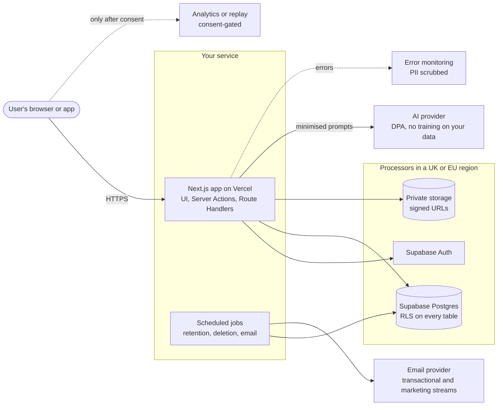

<a id="p3"></a>
## Part 3 — Technical requirements & architecture (TRD) `[CORE]`

### 3.1 Stack decisions

Pin exact versions at project start (lockfile plus this table), and change them only through an ADR. The reference stack below is the default for web projects.

| Layer | Choice (reference default) | Pinned version | Why | ADR |
|---|---|---|---|---|
| Framework | Next.js (App Router) + React + TypeScript `strict` | {{ }} | One codebase for UI and server; Server Components | ADR-001 |
| Styling & motion | Tailwind CSS · Motion (formerly Framer Motion), honouring `prefers-reduced-motion` | {{ }} | Speed and consistency | — |
| Server logic | Server Actions for internal mutations · Route Handlers for webhooks and the public API | — | Typed end to end | ADR-001 |
| Database | PostgreSQL on Supabase in a {{UK/EU}} region · Prisma ORM · RLS on every table | {{ }} | Relational data, type safety, defence in depth | ADR-002, ADR-005 |
| Auth | Supabase Auth: Google OAuth + magic link; MFA for owners and admins | — | Managed, standards-based | ADR-002 |
| Validation & forms | Zod (schemas shared by client and server) · React Hook Form | {{ }} | One source of truth for input rules | — |
| Client state | TanStack Query for server state · Zustand for UI state (e.g. active filters) | {{ }} | Caching, retries, offline handling | — |
| AI | {{Provider}} through the Vercel AI SDK · model `{{pinned model ID}}` | {{ }} | Structured output, streaming | ADR-006 |
| Email | {{Provider}} with separate transactional and marketing streams | — | Deliverability and compliance | ADR-007 |
| Hosting | Vercel, functions region {{`lhr1` London / `fra1` Frankfurt}} | — | Preview deployments | ADR-005 |
| Monitoring | {{e.g. Sentry}} (EU data region, PII scrubbing, replay off) | — | Error visibility | 9.10 |
| Analytics | {{Privacy-first, aggregate tool}} | — | Measure without tracking people | 9.10 |
| Testing | Vitest · Playwright · @axe-core/playwright | {{ }} | Covers Part 11 | — |

> **Mobile or other stacks** (Flutter, React Native, native): keep this table's structure and add app-store privacy labels, account deletion (9.25), SDK inventories (9.8) and OS permission flows (9.14).

### 3.2 Environments

| Env | Purpose | Data allowed | Access | Secrets |
|---|---|---|---|---|
| Local | Development | Synthetic seed data only | Developer | `.env.local` (git-ignored) |
| Preview | One per pull request | Synthetic only | Team (deployment protection on) | Preview-scoped variables |
| Staging | Release candidate testing | Synthetic, or anonymised extracts with written approval | Team | Staging project and keys |
| Production | Live | Real | Least privilege, MFA | Production project and keys |

**Rule:** real personal data never leaves production. Each environment has its own Supabase project and keys.

### 3.3 System context



### 3.4 Data flows & trust boundaries

| Flow | From → To | Personal data | Boundary crossed | Protection |
|---|---|---|---|---|
| Sign-up | Browser → Auth | Email, name, IP | Internet → processor | TLS; rate limits; no third-party scripts on auth pages |
| Task CRUD | Browser → Server Action → DB | Task content, names | Client → server → DB | Zod validation; authorisation check; RLS |
| AI standup | Server → AI provider | Minimised task text | You → third country | DPA; redaction; transfer mechanism (9.17) |
| Email | Job → email provider | Email address, name | You → processor | DPA; suppression list; one-click unsubscribe |
| Errors | App → monitoring | Stack traces, IDs | You → processor | PII scrubbing; no request bodies |

### 3.5 Repository structure

```text
app/                    routes: (marketing)/, (auth)/, (app)/w/[slug]/…, api/
components/ui/          primitives (button, input, dialog …)
components/states/      the reusable UI-state components (10.7)
components/features/    feature components
lib/schemas/            Zod schemas shared by client and server
lib/server/             server-only code (import 'server-only'): data access, authorisation
lib/privacy/            consent store, script loader, redaction, export and deletion helpers
lib/ai/                 versioned prompts, output schemas, evals
prisma/                 schema.prisma, migrations/   ·   prisma.config.ts at repo root
supabase/policies/      RLS SQL (5.4)          supabase/seed.sql (synthetic data)
tests/                  unit/  integration/  e2e/  privacy/  a11y/  rls/
docs/                   BLUEPRINT.md  adr/  compliance/ (RoPA, DPIA, LIAs, registers)
```

### 3.6 Third-party services & processors register

Every service that receives personal data or runs in the user's browser **must** be listed here before it is added to the code.

| Service | Purpose | Data shared | Runs in browser? | Before consent? | Role | Location · Transfer mechanism | DPA signed | Exit plan |
|---|---|---|---|---|---|---|---|---|
| {{Vercel}} | Hosting | Request logs (IP) | No | n/a | Processor | {{EU/US · DPF + SCCs}} | {{date}} | {{ }} |
| {{Supabase}} | DB, auth, storage | All app data | Client SDK | Yes (strictly necessary) | Processor | {{eu-west-2 London}} | {{ }} | {{ }} |
| {{AI provider}} | Standups | Minimised task text | No | n/a | Processor | {{US · DPF / SCCs}} | {{ }} | {{ }} |
| {{Email provider}} | Email | Email, name | No | n/a | Processor | {{ }} | {{ }} | {{ }} |
| {{Analytics}} | Aggregate metrics | Pseudonymous events | Yes | **No** | Processor | {{ }} | {{ }} | {{ }} |

### 3.7 Configuration & secrets

| Variable | Scope | Purpose | Stored in | Rotation |
|---|---|---|---|---|
| `NEXT_PUBLIC_SUPABASE_URL` | Client (public) | Project URL | Vercel env | On project change |
| `NEXT_PUBLIC_SUPABASE_PUBLISHABLE_KEY` | Client (public) | Publishable (anon) key. Safe only because RLS is on. | Vercel env | On leak |
| `SUPABASE_SECRET_KEY` | **Server only** | Secret / service-role key: bypasses RLS | Vercel env | Every 90 days and on leak |
| `DATABASE_URL` · `DIRECT_URL` | **Server only** | Pooled runtime connection · direct connection for migrations | Vercel env | On leak |
| `{{AI}}_API_KEY` · `{{EMAIL}}_API_KEY` | **Server only** | Provider keys | Vercel env | Every 90 days |

Rules:
- Anything prefixed `NEXT_PUBLIC_` ships to every visitor, so it must never be a secret.
- `.env*` files are git-ignored, and secret scanning (e.g. gitleaks) runs in CI.
- Each environment has separate keys.
- CI fails if the built client bundle contains a secret-key pattern.

### 3.8 Coding standards

- TypeScript `strict` with no `any` unless a comment justifies it. ESLint (including `jsx-a11y`) and Prettier run on every commit.
- Server-only modules start with `import 'server-only'`.
- Validate every input at every boundary with Zod: `.strict()` objects and a maximum length on every string.
- Errors use typed codes (6.3) that map to UI states (10.7). Never show stack traces to users.
- Logs are structured JSON with a correlation ID and no personal data (7.5).
- Store times in UTC, money in minor units (integer pence/kobo) and IDs as UUIDs.
