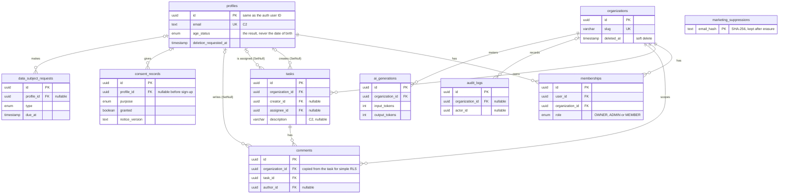

<a id="p5"></a>
## Part 5 — Data architecture `[CORE]`

### 5.1 Data classification

| Class | Examples | Storage | Logs, analytics, replay, error tools | AI prompts | Access |
|---|---|---|---|---|---|
| **C0 Public** | Marketing pages, docs | Anywhere | Allowed | Allowed | Anyone |
| **C1 Internal** | Aggregate metrics, configuration | App storage | Allowed | Allowed | Team |
| **C2 Personal** | Name, email, IP, user ID, workspace content about people | Encrypted at rest; RLS | IDs only, never content | Minimised and redacted only | Least privilege |
| **C3 Sensitive** | Special category data (9.13), children's data, precise location, government IDs, financial details, credentials | Separate tables; app-level encryption where feasible; access logged | **Never** | Only with an approved DPIA | Named roles; audited |

### 5.2 Data dictionary

Every field has a reason to exist. If you can't fill the "Purpose" column, delete the field.

| Entity.field | Type | Class | Purpose | ROPA | Required | Retention | Shared with |
|---|---|---|---|---|---|---|---|
| profiles.email | text | C2 | Sign-in, service email | ROPA-01 | Yes | Life of account | Auth, email provider |
| profiles.age_status | enum | C2 | Prove the age rule was applied (9.12) | ROPA-01 | Yes | Life of account | — |
| tasks.description | varchar(10000) | C2 | Core feature | ROPA-02 | No | Life of workspace | AI provider (minimised) |
| {{ }} | | | | | | | |

### 5.3 Reference schema (Prisma)

Changes from v1:
- `snake_case` mapping, UUID columns, indexes and length limits.
- `creator` and `author` become `SetNull`, so deleting a user no longer fails or wipes team content.
- New tables: consent evidence, marketing suppressions, rights requests and complaints, audit log, and an AI usage ledger.
- The date of birth is never stored; only the age-check result is.

**Entity relationships.** The backend schema at a glance, showing keys and the fields that matter for privacy. Keep it in step with the Prisma schema below; `SetNull` relations keep team content when a person is erased.



```prisma
// prisma/schema.prisma — privacy-aware reference schema (example: TaskFlow AI)
// Conventions: snake_case tables/columns (@@map/@map), UUID keys, UTC timestamps.
// Data classes in comments: [C2] personal, [C3] sensitive — see 5.1.

generator client {
  provider = "prisma-client-js"
}

datasource db {
  provider = "postgresql" // Prisma 7+: the connection URL lives in prisma.config.ts
}

/// One row per auth user. id = auth.users.id (set by a sign-up trigger).
model Profile {
  id                  String          @id @db.Uuid
  email               String          @unique // [C2]
  displayName         String          @map("display_name") // [C2]
  avatarPath          String?         @map("avatar_path") // [C2] own storage bucket, never Gravatar
  locale              String          @default("en-GB")
  timezone            String          @default("Europe/London")
  ageStatus           AgeStatus       @default(UNVERIFIED) @map("age_status") // store the result, not the DOB
  ageCheckMethod      AgeCheckMethod? @map("age_check_method")
  ageCheckedAt        DateTime?       @map("age_checked_at")
  lastActiveAt        DateTime?       @map("last_active_at") // drives inactive-account deletion
  deletionRequestedAt DateTime?       @map("deletion_requested_at") // starts the 30-day erasure grace period
  createdAt           DateTime        @default(now()) @map("created_at")
  updatedAt           DateTime        @updatedAt @map("updated_at")

  memberships   Membership[]
  assignedTasks Task[]               @relation("AssignedTasks")
  createdTasks  Task[]               @relation("CreatedTasks")
  comments      Comment[]
  consents      ConsentRecord[]
  requests      DataSubjectRequest[]

  @@map("profiles")
}

model Organization {
  id        String    @id @default(uuid()) @db.Uuid
  name      String    @db.VarChar(120)
  slug      String    @unique @db.VarChar(60)
  createdAt DateTime  @default(now()) @map("created_at")
  updatedAt DateTime  @updatedAt @map("updated_at")
  deletedAt DateTime? @map("deleted_at") // soft delete; hard delete after 30 days

  memberships   Membership[]
  tasks         Task[]
  comments      Comment[]
  auditLogs     AuditLog[]
  aiGenerations AiGeneration[]

  @@map("organizations")
}

model Membership {
  id             String   @id @default(uuid()) @db.Uuid
  userId         String   @map("user_id") @db.Uuid
  organizationId String   @map("organization_id") @db.Uuid
  role           Role     @default(MEMBER)
  createdAt      DateTime @default(now()) @map("created_at")

  user         Profile      @relation(fields: [userId], references: [id], onDelete: Cascade)
  organization Organization @relation(fields: [organizationId], references: [id], onDelete: Cascade)

  @@unique([userId, organizationId])
  @@index([organizationId])
  @@map("memberships")
}

model Task {
  id             String     @id @default(uuid()) @db.Uuid
  organizationId String     @map("organization_id") @db.Uuid
  title          String     @db.VarChar(200)
  description    String?    @db.VarChar(10000) // [C2] may mention people: never sent to analytics
  status         TaskStatus @default(TODO)
  priority       Priority   @default(MEDIUM)
  aiSummary      String?    @map("ai_summary") // AI-generated: labelled in the UI (Part 8.6)
  assigneeId     String?    @map("assignee_id") @db.Uuid
  creatorId      String?    @map("creator_id") @db.Uuid // nullable so erasing a user keeps team content
  createdAt      DateTime   @default(now()) @map("created_at")
  updatedAt      DateTime   @updatedAt @map("updated_at")
  deletedAt      DateTime?  @map("deleted_at")

  organization Organization @relation(fields: [organizationId], references: [id], onDelete: Cascade)
  assignee     Profile?     @relation("AssignedTasks", fields: [assigneeId], references: [id], onDelete: SetNull)
  creator      Profile?     @relation("CreatedTasks", fields: [creatorId], references: [id], onDelete: SetNull)
  comments     Comment[]

  @@index([organizationId, status])
  @@index([assigneeId])
  @@map("tasks")
}

model Comment {
  id             String    @id @default(uuid()) @db.Uuid
  organizationId String    @map("organization_id") @db.Uuid // denormalised: simple, fast RLS
  taskId         String    @map("task_id") @db.Uuid
  authorId       String?   @map("author_id") @db.Uuid
  content        String    @db.VarChar(5000) // [C2]
  createdAt      DateTime  @default(now()) @map("created_at")
  editedAt       DateTime? @map("edited_at")

  organization Organization @relation(fields: [organizationId], references: [id], onDelete: Cascade)
  task         Task         @relation(fields: [taskId], references: [id], onDelete: Cascade)
  author       Profile?     @relation(fields: [authorId], references: [id], onDelete: SetNull)

  @@index([taskId, createdAt])
  @@map("comments")
}

/// Append-only evidence of every consent decision (9.7). Never update rows; insert a new one.
model ConsentRecord {
  id            String         @id @default(uuid()) @db.Uuid
  profileId     String?        @map("profile_id") @db.Uuid
  anonymousId   String?        @map("anonymous_id") // random ID from the consent cookie, before sign-up
  purpose       ConsentPurpose
  granted       Boolean
  noticeVersion String         @map("notice_version") // version of the notice shown
  wording       String // exact text the person saw
  source        ConsentSource
  createdAt     DateTime       @default(now()) @map("created_at")

  profile Profile? @relation(fields: [profileId], references: [id], onDelete: SetNull)

  @@index([profileId, purpose, createdAt])
  @@map("consent_records")
}

/// Minimal record kept after unsubscribe or erasure so the address is never emailed again.
model MarketingSuppression {
  emailHash String            @id @map("email_hash") // SHA-256 of the lower-cased, trimmed email
  reason    SuppressionReason
  createdAt DateTime          @default(now()) @map("created_at")

  @@map("marketing_suppressions")
}

/// Rights requests and privacy complaints (9.15, 9.16).
model DataSubjectRequest {
  id             String    @id @default(uuid()) @db.Uuid
  profileId      String?   @map("profile_id") @db.Uuid
  requesterEmail String    @map("requester_email") // [C2]
  type           DsrType
  status         DsrStatus @default(RECEIVED)
  jurisdiction   String? // e.g. "UK", "EU-IE", "NG"
  receivedAt     DateTime  @default(now()) @map("received_at")
  acknowledgedAt DateTime? @map("acknowledged_at")
  dueAt          DateTime  @map("due_at") // one calendar month from receipt (UK/EU)
  extendedTo     DateTime? @map("extended_to")
  completedAt    DateTime? @map("completed_at")
  outcomeNote    String?   @map("outcome_note") // no special category details

  profile Profile? @relation(fields: [profileId], references: [id], onDelete: SetNull)

  @@index([status, dueAt])
  @@map("data_subject_requests")
}

/// Security and admin events. IDs only: no emails, names or content.
model AuditLog {
  id             String   @id @default(uuid()) @db.Uuid
  organizationId String?  @map("organization_id") @db.Uuid
  actorId        String?  @map("actor_id") @db.Uuid
  action         String // e.g. "member.role_changed", "data.exported"
  targetType     String?  @map("target_type")
  targetId       String?  @map("target_id")
  metadata       Json?
  createdAt      DateTime @default(now()) @map("created_at")

  organization Organization? @relation(fields: [organizationId], references: [id], onDelete: SetNull)

  @@index([organizationId, createdAt])
  @@map("audit_logs")
}

/// Usage and cost ledger for AI features. Prompts and outputs are NOT stored here.
model AiGeneration {
  id             String   @id @default(uuid()) @db.Uuid
  organizationId String   @map("organization_id") @db.Uuid
  requestedById  String?  @map("requested_by_id") @db.Uuid
  feature        String // e.g. "standup_summary"
  model          String // pinned model ID
  promptVersion  String   @map("prompt_version")
  inputTokens    Int      @map("input_tokens")
  outputTokens   Int      @map("output_tokens")
  status         String // "succeeded" | "failed" | "cancelled"
  createdAt      DateTime @default(now()) @map("created_at")

  organization Organization @relation(fields: [organizationId], references: [id], onDelete: Cascade)

  @@index([organizationId, createdAt])
  @@map("ai_generations")
}

enum Role {
  OWNER
  ADMIN
  MEMBER
}

enum TaskStatus {
  TODO
  IN_PROGRESS
  IN_REVIEW
  DONE
}

enum Priority {
  LOW
  MEDIUM
  HIGH
  URGENT
}

enum AgeStatus {
  UNVERIFIED
  ADULT
  MINOR_WITH_PARENTAL_CONSENT
}

enum AgeCheckMethod {
  SELF_DECLARATION
  AGE_ESTIMATION
  ID_CHECK_VIA_PROVIDER
  PARENT_VERIFIED
}

// Extend from your RoPA (9.3). One purpose per independent choice.
enum ConsentPurpose {
  ANALYTICS
  SESSION_REPLAY
  MARKETING_EMAIL
  PRODUCT_UPDATES
  PARENTAL
  SPECIAL_CATEGORY_EXPLICIT
}

enum ConsentSource {
  SIGNUP_FORM
  WAITLIST_FORM
  COOKIE_BANNER
  PRIVACY_SETTINGS
  DOUBLE_OPT_IN
  PARENT_PORTAL
}

enum DsrType {
  ACCESS
  RECTIFICATION
  ERASURE
  RESTRICTION
  OBJECTION
  PORTABILITY
  AUTOMATED_DECISION_REVIEW
  COMPLAINT
}

enum DsrStatus {
  RECEIVED
  VERIFYING
  IN_PROGRESS
  EXTENDED
  COMPLETED
  REFUSED
}

enum SuppressionReason {
  UNSUBSCRIBED
  HARD_BOUNCE
  SPAM_COMPLAINT
  ERASURE_REQUEST
}
```

**Prisma 7+** rejects `url` inside `schema.prisma`. Put the connection in `prisma.config.ts`, and give `PrismaClient` a driver adapter (e.g. `@prisma/adapter-pg`) that uses the pooled `DATABASE_URL` at runtime. On Prisma 6, put `url = env("DATABASE_URL")` and `directUrl = env("DIRECT_URL")` back in the `datasource` block instead.

```ts
// prisma.config.ts (repo root) — Prisma 7+
import { defineConfig, env } from 'prisma/config';

export default defineConfig({
  schema: 'prisma/schema.prisma',
  migrations: { path: 'prisma/migrations' },
  // Migrations need a direct (non-pooled) connection; the app uses a driver adapter at runtime.
  datasource: { url: env('DIRECT_URL') },
});
```

> **Erasure decision:** when a member deletes their account, decide whether the content they authored is deleted or kept with the author shown as "Deleted user". In B2B, the customer workspace is the controller of that content (9.2), so follow its instructions.

### 5.4 Row-Level Security (Supabase)

Missing or wrong RLS is the most common data-exposure bug in AI-generated Supabase apps. The rules:
- Enable RLS on **every** table.
- Never trust `user_metadata`, which users can edit, in policies.
- Never ship the secret or service-role key to the client.

> **No RLS in your database?** MySQL, MariaDB and SQLite have no row-level security. Enforce the same rules in the data layer: scope every query by tenant and user (for example Laravel global scopes and Policies, Rails Pundit policy scopes, or Django custom managers), allow no raw query that skips the scope, and keep the same isolation tests: as anonymous, as a member, and as another tenant.

```sql
-- supabase/policies/001_rls.sql — run after the Prisma migration that creates the tables.

-- 1) Turn RLS on for EVERY table in the exposed schema. RLS on + no policy = no access (safe default).
alter table public.profiles               enable row level security;
alter table public.organizations          enable row level security;
alter table public.memberships            enable row level security;
alter table public.tasks                  enable row level security;
alter table public.comments               enable row level security;
alter table public.consent_records        enable row level security;  -- server-only: no policies
alter table public.marketing_suppressions enable row level security;  -- server-only: no policies
alter table public.data_subject_requests  enable row level security;  -- server-only: no policies
alter table public.audit_logs             enable row level security;  -- server-only: no policies
alter table public.ai_generations         enable row level security;  -- server-only: no policies

-- 2) Helper functions live in a schema the API does not expose.
--    SECURITY DEFINER avoids recursive RLS on memberships; search_path is pinned for safety.
create schema if not exists private;
grant usage on schema private to authenticated;

create or replace function private.is_member(org uuid)
returns boolean
language sql
stable
security definer
set search_path = ''
as $$
  select exists (
    select 1
    from public.memberships m
    where m.organization_id = org
      and m.user_id = (select auth.uid())
  );
$$;

create or replace function private.has_role(org uuid, allowed text[])
returns boolean
language sql
stable
security definer
set search_path = ''
as $$
  select exists (
    select 1
    from public.memberships m
    where m.organization_id = org
      and m.user_id = (select auth.uid())
      and m.role::text = any (allowed)
  );
$$;

revoke execute on function private.is_member(uuid) from public;
revoke execute on function private.has_role(uuid, text[]) from public;
grant execute on function private.is_member(uuid) to authenticated;
grant execute on function private.has_role(uuid, text[]) to authenticated;

-- 3) Policies. Always name the role (to authenticated) and wrap auth.uid() in a sub-select (faster).
create policy "profiles: read own"
  on public.profiles for select to authenticated
  using (id = (select auth.uid()));

create policy "profiles: update own"
  on public.profiles for update to authenticated
  using (id = (select auth.uid()))
  with check (id = (select auth.uid()));

create policy "organizations: members read"
  on public.organizations for select to authenticated
  using (private.is_member(id));

create policy "memberships: members read their org"
  on public.memberships for select to authenticated
  using (private.is_member(organization_id));

create policy "tasks: members read"
  on public.tasks for select to authenticated
  using (private.is_member(organization_id));

create policy "tasks: members create as themselves"
  on public.tasks for insert to authenticated
  with check (private.is_member(organization_id) and creator_id = (select auth.uid()));

create policy "tasks: members update"
  on public.tasks for update to authenticated
  using (private.is_member(organization_id))
  with check (private.is_member(organization_id));

create policy "tasks: owners and admins delete"
  on public.tasks for delete to authenticated
  using (private.has_role(organization_id, array['OWNER', 'ADMIN']));

create policy "comments: members read"
  on public.comments for select to authenticated
  using (private.is_member(organization_id));

create policy "comments: members write as themselves"
  on public.comments for insert to authenticated
  with check (private.is_member(organization_id) and author_id = (select auth.uid()));
```

Run a tenant-isolation test in CI against a local Supabase stack (never production):

```sql
-- tests/rls/tenant_isolation.sql — run against a local Supabase stack (never production).
begin;
  -- Act as user A (a member of org A only).
  set local role authenticated;
  set local request.jwt.claims = '{"sub": "00000000-0000-0000-0000-00000000000a", "role": "authenticated"}';

  -- Must return 0: user A cannot see org B's tasks.
  select count(*) as leaked_rows
  from public.tasks
  where organization_id = '00000000-0000-0000-0000-0000000000b0';

  -- Must fail with an RLS violation: user A cannot write into org B.
  insert into public.tasks (id, organization_id, title, creator_id, updated_at)
  values (gen_random_uuid(), '00000000-0000-0000-0000-0000000000b0', 'should fail',
          '00000000-0000-0000-0000-00000000000a', now());
rollback;
```

### 5.5 Migrations & seed data

- Every schema change is a committed migration. Never edit a migration that has already been applied.
- Make breaking changes in steps: **expand** (add new) → migrate data → **contract** (remove old).
- `supabase/seed.sql` holds synthetic data only: one user per role, two organisations (to test isolation), and edge cases such as an empty workspace and very long text.

### 5.6 Retention & deletion schedule

Defaults to adjust per project. Deletion is implemented as code (scheduled jobs plus tests), not as a policy promise.

| Data | Retention | Trigger | Method |
|---|---|---|---|
| Account profile | Life of account | User deletes account → 30-day grace period | Hard delete; cascades; processor propagation (9.15) |
| Workspace content | Life of workspace | Owner deletes workspace → 30-day recovery | Hard delete |
| Inactive accounts | {{24 months}} without sign-in | Warning email 30 days before | Hard delete |
| Security & audit logs | {{12 months}} audit · {{90 days}} auth events | Rolling | TTL job |
| Application logs (no personal data) | {{30 days}} | Rolling | Provider setting |
| Error-monitoring events | {{30–90 days}} | Rolling | Provider setting |
| Aggregate analytics | {{≤ 25 months}} | Rolling | Provider setting |
| Session replays (if used at all) | ≤ 30 days | Rolling | Provider setting |
| Consent records | Life of the consent + {{6 years}} | — | Archive, then delete |
| Marketing suppression list | Indefinitely (hashed email only) | Needed to honour the opt-out | — |
| Rights requests & complaints | {{3 years}} after closure | — | Delete |
| Invoices & payment records | 6 years from the end of the financial year (UK tax) | — | Delete |
| AI prompts & outputs held by the provider | Provider's minimum (aim for zero retention) | — | Contract (ADR-006) |
| Backups | {{30 days}} rolling | Deleted data ages out of backups; say so in the privacy notice | Never restore deleted records: re-apply the deletion log after any restore |

> **Nigeria:** where no law sets a period, stop storing data no later than 6 months after its purpose is achieved, unless it's needed for legal claims (GAID Art. 49). Tell people your retention policy (9.6).

### 5.7 Backups & disaster recovery

- Turn on automated daily backups. Add point-in-time recovery if RPO < 24 h. Backups stay encrypted and in-region.
- Run a **quarterly restore drill** into a scratch project: record the time taken and any problems, and re-apply the deletion log afterwards.
- Keep a runbook (11.5) for DB restore, key rotation and rollback.
