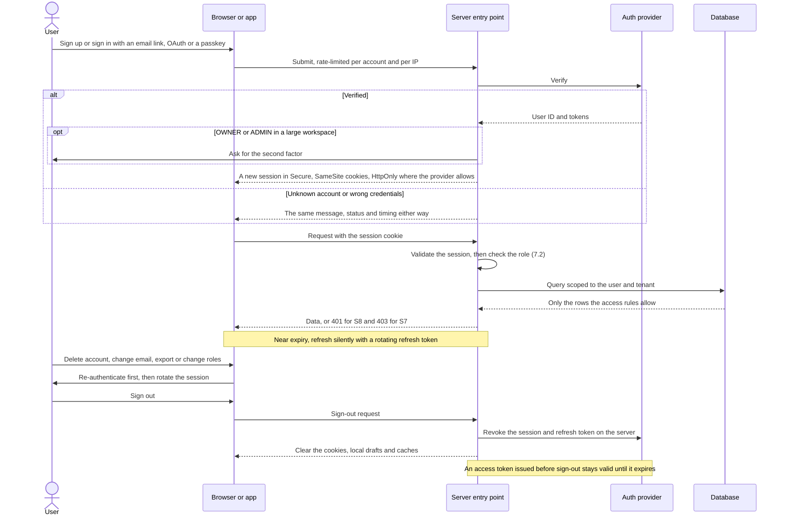

<a id="p7"></a>
## Part 7 — Identity, access & security `[CORE]`

### 7.1 Authentication

- **Methods:** {{Google OAuth · magic link · passkeys}}. Request the minimum OAuth scopes (`openid email profile`).
- **Sessions:**
  - Short-lived access tokens (Supabase default: 1 hour) with rotating refresh tokens.
  - Refresh silently, and warn before a hard expiry (S8, WCAG 2.2.1).
  - Sign-out clears local drafts and caches.
- **Re-authentication** is required for deleting the account, changing email, exporting data, changing roles and billing.
- **MFA:** TOTP or passkey, required for OWNER/ADMIN roles in workspaces with {{> 5}} members and for any internal admin console.
- **No account enumeration:** sign-in, sign-up and reset give the same response whether or not the account exists.
- **Recovery:** verified email only. Notify the user when the email, MFA or sign-in method changes.
- **Passwords (if used):** check against breached-password lists, allow paste and password managers (WCAG 3.3.8), set no composition rules beyond length ≥ 12, and rate-limit attempts.

**Authentication flow.** Adapt it to your provider (Supabase Auth, Auth.js, Clerk, Firebase, Laravel Sanctum, Django) and keep the rules in the notes, which follow the OWASP Authentication and Session Management cheat sheets (Appendix B).



- A new session ID is issued at sign-in and whenever privileges change, so an old or planted one can't be reused.
- Cookies are `Secure`, with `SameSite=Lax` or `Strict` and no `Domain` attribute. Make them `HttpOnly` where your provider allows. Some SSR clients, Supabase's among them, keep the session in cookies that browser code reads, so a strict CSP (7.4) and short-lived tokens carry more of the weight.
- Sign-out revokes the session and refresh token on the server; deleting the cookie alone isn't enough. An access token issued before sign-out stays valid until it expires, so keep tokens short-lived, and before a sensitive action check the session with the provider on the server (with Supabase, `getClaims()` or `getUser()`, never `getSession()`).
- Errors and timing are the same whether or not the account exists, and repeated failures are throttled per account, not only per IP.

### 7.2 Authorisation

Deny by default. Enforce at three layers:
1. **Database:** RLS (5.4), or the same rules enforced in the data layer where the database has no RLS.
2. **Server:** `assertCan(user, action, resource)` in the data-access layer.
3. **UI:** hide or disable controls. This is a convenience, never protection.

| Action | OWNER | ADMIN | MEMBER |
|---|---|---|---|
| View and create tasks, comment | ✅ | ✅ | ✅ |
| Edit any task | ✅ | ✅ | ✅ |
| Delete any task | ✅ | ✅ | ❌ (own drafts only) |
| Invite and remove members | ✅ | ✅ | ❌ |
| Change roles | ✅ | ❌ | ❌ |
| Billing & plan | ✅ | ❌ | ❌ |
| Export workspace data | ✅ | ✅ | ❌ |
| Delete workspace | ✅ (re-auth, type to confirm) | ❌ | ❌ |
| View audit log | ✅ | ✅ | ❌ |

The matrix is also a test fixture: an automated test checks every cell (11.3).

### 7.3 Threat model

Use STRIDE (Spoofing, Tampering, Repudiation, Information disclosure, Denial of service, Elevation of privilege) on each flow in 3.4. These threats are pre-filled because they are the most common failures in AI-built apps:

| ID | Threat | Scenario | Mitigation | Test |
|---|---|---|---|---|
| T-01 | Information disclosure | RLS missing, a policy uses `using (true)`, or queries aren't scoped | RLS on every table (data-layer scoping where the database has none); review every policy; tenant-isolation tests | 5.4 |
| T-02 | Elevation of privilege | The secret key is shipped in a `NEXT_PUBLIC_` variable or the client bundle | Secrets server-only; CI scans the bundle for key patterns | CI |
| T-03 | Elevation of privilege | IDOR: a Server Action trusts an `orgId` or `taskId` sent by the client | Re-derive tenancy on the server; `assertCan()` on every action | Integration |
| T-04 | Tampering | XSS through comments, Markdown or AI output | Allowlist sanitiser; CSP with nonces; no unsanitised HTML | E2E + DAST |
| T-05 | Tampering | Prompt injection in task or comment text that the AI reads | Treat content as data; no side-effect tools without user confirmation; validate output (8.4) | Eval set |
| T-06 | Information disclosure | SSRF through link previews, URL imports or webhook targets | Allowlist schemes and hosts; block private IP ranges; timeouts | Unit |
| T-07 | Tampering | Malicious or oversized uploads | Type and size checks; private buckets; signed URLs; scan shared files | Integration |
| T-08 | Spoofing | Credential stuffing or magic-link abuse | Rate limits, MFA, short-lived single-use links | E2E |
| T-09 | Denial of service | AI or export endpoints used to run up costs | Auth required; quotas; spend caps (8.7) | Load test |
| T-10 | Information disclosure | Third-party scripts, fonts or replay tools leak data | ADR-004; consent-gated loader; CSP | Privacy test (9.9) |
| T-11 | Information disclosure | Verbose errors or stack traces reach the client | Generic messages + `ref`; details only in logs | E2E |
| T-12 | Tampering | Supply chain: malicious, typosquatted or AI-hallucinated packages | Check that a package exists and is maintained before installing; lockfile; automated updates; audit in CI | CI |
| {{T-13}} | {{ }} | {{ }} | {{ }} | {{ }} |

### 7.4 Security controls baseline

- [ ] **HTTP headers:**
  - `Strict-Transport-Security: max-age=63072000; includeSubDomains; preload`
  - `X-Content-Type-Options: nosniff`
  - `Referrer-Policy: strict-origin-when-cross-origin`
  - `Permissions-Policy` that disables camera, microphone, geolocation and payment unless they're needed
- [ ] **Content Security Policy**, generated per request with a nonce. Start in `Content-Security-Policy-Report-Only`, review the reports, then enforce:

```text
default-src 'self';
script-src 'self' 'nonce-{NONCE}' 'strict-dynamic';
style-src 'self' 'unsafe-inline';
img-src 'self' blob: data: https://{{project-ref}}.supabase.co;
font-src 'self';
connect-src 'self' https://{{project-ref}}.supabase.co wss://{{project-ref}}.supabase.co https://{{error-ingest-host}};
frame-src 'none';
frame-ancestors 'none';
base-uri 'self';
form-action 'self';
object-src 'none';
upgrade-insecure-requests
```

  `font-src 'self'` alone blocks the Google Fonts leak (9.9). Add hosts only when a consented or strictly necessary feature needs them (for example, the payment provider's frame on checkout).
- [ ] **Cookies** are `Secure; HttpOnly; SameSite=Lax`. Session cookies are host-only.
- [ ] **CSRF:** Server Actions are POST-only and checked against the origin by Next.js. Route Handlers that change state verify `Origin` and use SameSite cookies.
- [ ] **Encryption:**
  - TLS 1.2+ everywhere.
  - Provider encryption at rest.
  - App-level encryption for C3 fields where feasible.
- [ ] **Least privilege:** separate DB roles for migrations and runtime; production access only through MFA; quarterly access review.
- [ ] **Scanning in CI:** secrets (gitleaks), dependencies (`npm audit` plus Dependabot or Renovate), static analysis (CodeQL or Semgrep). Run DAST (OWASP ZAP baseline) against staging before launch.
- [ ] **Pen test** before launch for High-tier projects, then annually.
- [ ] **Assurance for B2B and public-sector buyers:** Cyber Essentials (UK); ISO 27001 or SOC 2 when enterprise buyers ask.

### 7.5 Logging & audit

| Log this | Never log this |
|---|---|
| Sign-ins, failures, MFA changes, permission denials, role changes, exports, deletions, consent changes, admin actions (to `audit_logs`) | Passwords, tokens, magic links, API keys, full request bodies, email addresses (use IDs), C3 data, payment data, AI prompts that contain personal data |

Logs are structured, carry a correlation ID, are kept for the periods in 5.6, and only named roles can read them.

### 7.6 Vulnerability management

- **Patch windows:** critical within {{7 days}}, high within {{30 days}}. Update dependencies weekly.
- **Disclosure:** publish `/.well-known/security.txt` (RFC 9116) with `Contact` and `Expires`.
- **Secret leaks:** rotate the secret immediately, purge it from git history, review the access logs and assess whether it's a breach (9.20).
