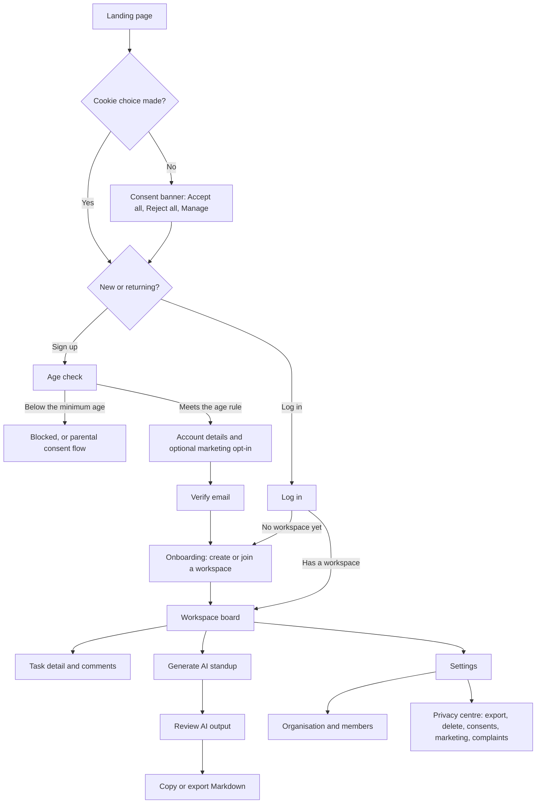
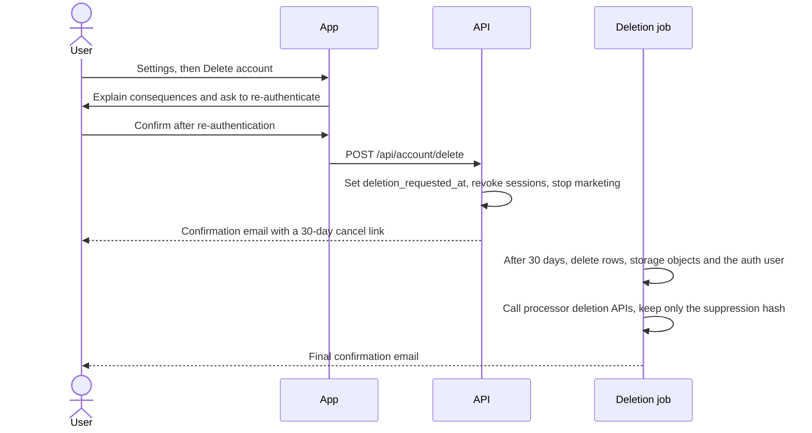

<a id="p10"></a>
## Part 10 — Experience design: flows, design system, accessibility, UI states `[CORE]`

### 10.1 Primary user journey

The **app flow** is this journey diagram, the key flows in 10.2 and the navigation map in 10.3. Together they show every screen, how people move between them, and where each failure leads.



**Navigation:** client-side routing via the App Router. The URL holds shareable state (workspace, filters, open task); Zustand holds ephemeral UI state only.

### 10.2 Key secondary flow: account deletion



Also diagram: **session expiry and draft restore** (S8), **data export** (async job → email with an expiring link), **invite member**, **AI standup generation** (S14 with cancel).

### 10.3 Route & screen inventory

| SCR | Route | Screen | Access | Primary action | Data shown | Analytics | Replay |
|---|---|---|---|---|---|---|---|
| SCR-01 | `/` | Landing | Public | Sign up | C0 | Aggregate | If consented |
| SCR-02 | `/signup` | Sign-up + age check | Public | Create account | C2 | Aggregate | **Never** |
| SCR-03 | `/login` | Log in | Public | Sign in | C2 | Aggregate | **Never** |
| SCR-04 | `/onboarding` | Create or join workspace | Authenticated | Create | C2 | Aggregate | If consented |
| SCR-05 | `/w/[slug]` | Board | Member | Create task | C2 | Aggregate | If consented, masked |
| SCR-06 | `/w/[slug]/t/[id]` | Task detail (modal) | Member | Comment | C2 | Aggregate | If consented, masked |
| SCR-07 | `/w/[slug]/standup` | AI standup | Member | Generate | C2 | Aggregate | If consented, masked |
| SCR-08 | `/w/[slug]/settings/members` | Members | Admin+ | Invite | C2 | Aggregate | **Never** |
| SCR-09 | `/settings/privacy` | Privacy centre | Self | Export / delete | C2 | None | **Never** |
| SCR-10 | `/legal/privacy` · `/legal/cookies` · `/legal/terms` | Legal pages | Public | — | C0 | Aggregate | If consented |

**Navigation map.** One row per action that moves the user, so no screen is a dead end and every failure lands on a designed state (10.7):

| From | Action | Goes to | If it fails |
|---|---|---|---|
| SCR-01 Landing | Sign up | SCR-02 Sign-up | — |
| SCR-01 Landing | Log in | SCR-03 Log in | — |
| SCR-02 Sign-up | Create account | The age check, then a "Check your email" panel; verifying the email opens SCR-04 | S9 field errors · S3 with Retry · below the minimum age, the block or parental-consent flow (10.1) |
| SCR-03 Log in | Sign in | The last workspace (SCR-05), or SCR-04 if there's none | S9 · the same message for any unknown account (7.1) · S13 after repeated tries |
| SCR-04 Onboarding | Create or join a workspace | SCR-05 Board | S9 (slug taken) · S11 (invite expired) |
| SCR-05 Board | Open a task | SCR-06 Task detail, as a modal with its own URL | S11 if it was deleted |
| SCR-06 Task detail | Comment | The comment appears in place (S10) | S9 · S3 with the text kept |
| SCR-06 Task detail | Close (Esc or Back) | SCR-05, with focus back on the task | — |
| SCR-05 Board | Generate standup | SCR-07 Standup | S13 quota · S15 if AI is switched off |
| SCR-07 Standup | Generate | S14 progress, then the result; Copy gives S10 | S3 · S5, then Cancel · S13 |
| SCR-05 Board | Settings, then Members | SCR-08 Members | S7 for a MEMBER |
| SCR-08 Members | Invite member | S10 "Invite sent" | S9 · S3 |
| Any signed-in screen | Account menu, then Privacy | SCR-09 Privacy centre | S8 |
| SCR-09 Privacy centre | Export my data | S14, then an email with an expiring download link (10.2) | S13 (3 exports a day, 6.6) · S3 |
| SCR-09 Privacy centre | Delete account | S16 confirmation, re-authentication, then the 30-day flow in 10.2 | S8 if the session has expired |
| Any screen | A footer link | SCR-10 Legal pages; "Cookie settings" reopens the consent choices (9.8) | — |
| Any signed-in screen | Sign out | SCR-01, with the session revoked and local drafts and caches cleared (7.1) | — |
| Any screen | The session expires | A sign-in modal, then back to the same place with the draft | S8 |
| Any screen | An unknown or deleted route | S11 with a link back | — |

### 10.4 Screen specification template

```text
SCR-NN — {{Screen name}}                         Route: {{ }}     Access: {{roles}}
Purpose & primary action: {{ }}
Layout: {{regions, e.g. header · sidebar · main · detail panel; what moves or collapses on mobile}}
Actions → next: {{each action → the screen or result it leads to (navigation map, 10.3), and the state on failure}}
Components: {{ }}              Data (DATA- refs, classes): {{ }}       API: {{API- refs}}
States (10.7): S1 {{…}} · S2 {{…}} · S3 {{…}} · … (or N/A + reason)
Copy: title, empty-state text, error text, success text (10.5 content rules)
Accessibility: heading order, focus on open, keyboard path, live regions, target sizes
Analytics events (aggregate only): {{ }}          Replay: allowed / never
Responsive: 320 / 768 / 1280 behaviour
```

### 10.5 Design system

**Look-and-feel brief.** Fill this in before choosing tokens. It's the design brief that a designer or an agent works from, and it settles taste questions before they turn into rework:

```text
Personality: {{three words, e.g. calm · precise · friendly}}
Audience & context: {{who, on which devices, how often, in what setting}}
References: {{2–3 products whose look or flow you like, and exactly what you like about each}}
Avoid: {{styles, patterns or clichés to stay away from}}
Density: compact | comfortable          Theme: dark first | light first | follow the system
Brand assets: {{logo, existing colours and fonts, or "none yet"}}
Type & icons: {{UI and code typefaces (self-hosted, 9.9), one icon set, illustration or photo style}}
Voice & tone: {{e.g. plain and warm, British English, no exclamation marks in errors}}
Motion: none | subtle (150–250 ms) | expressive          Accessibility: WCAG 2.2 AA (not negotiable)
Design first: {{the SCR- IDs that set the pattern for the rest}}
```

**Principles:**
- Calm and fast.
- Accessible by default.
- Honest UI: no dark patterns.
- Every state is designed.

**Colour tokens.** Contrast ratios are calculated with the WCAG formula. Status colours always come with an icon and text, never colour alone.

| Token | Dark (default) | Light | Contrast (on surface) |
|---|---|---|---|
| `bg` | `#09090B` (zinc-950) | `#FFFFFF` | — |
| `surface` | `#18181B` (zinc-900) | `#FAFAFA` (zinc-50) | — |
| `surface-raised` | `#27272A` (zinc-800) | `#FFFFFF` + shadow | — |
| `text` | `#FAFAFA` (zinc-50) | `#18181B` (zinc-900) | 16.97:1 · 16.97:1 |
| `text-muted` | `#A1A1AA` (zinc-400) | `#52525B` (zinc-600) | 6.91:1 · 7.41:1 |
| `link`, `accent-text` | `#818CF8` (indigo-400) | `#4F46E5` (indigo-600) | 5.94:1 · 6.02:1 |
| `primary` (button fill, white label) | `#4F46E5` (indigo-600) | `#4F46E5` | White label 6.29:1 |
| `primary-hover` | `#4338CA` (indigo-700) | `#4338CA` | White label 7.90:1 |
| `border-control` (inputs, checkboxes) | `#71717A` (zinc-500) | `#71717A` | 3.67:1 · 4.83:1 on white (needs ≥ 3:1) |
| `border-subtle` (decorative only) | `#27272A` | `#E4E4E7` | Decorative |
| `focus-ring` (2 px + 2 px offset) | `#818CF8` | `#4F46E5` | 5.94:1 · 6.29:1 |
| `success` | `#4ADE80` | `#15803D` | 10.17:1 · 5.02:1 on white |
| `warning` | `#FBBF24` | `#B45309` | 10.61:1 · 5.02:1 on white |
| `danger` | `#F87171` | `#DC2626` | 6.40:1 · 4.83:1 on white |
| `info` | `#38BDF8` | `#0369A1` | 8.27:1 · 5.93:1 on white |

> v1's indigo-500 (`#6366F1`) is kept only for decorative accents. With a white label it gives 4.47:1, and as text on near-black 4.43:1; both are below the 4.5:1 that normal text needs.

**Typography:**
- Inter for the UI; JetBrains Mono for code, IDs and timestamps. Both are **self-hosted** through `next/font` (9.9).
- Scale (px): 12 · 14 · **16 (body)** · 18 · 20 · 24 · 30 · 36. Line height 1.5 for body text and 1.2 for headings.
- Form inputs use ≥ 16 px so iOS Safari doesn't auto-zoom.

**Layout & motion:**
- Spacing on a 4 px base (4, 8, 12, 16, 24, 32, 48, 64). Radius 6 / 8 / 12.
- Breakpoints: 640 / 768 / 1024 / 1280.
- Motion lasts 150–250 ms, ease-out. With `prefers-reduced-motion`, cross-fade or skip it.
- A z-index scale for dropdowns, modals and toasts.

**Components** (each designed for all of its states):
- button: default / hover / focus / active / disabled / loading
- input: default / focus / error / disabled / read-only
- select, checkbox, radio, switch
- dialog: focus trap, Esc, focus returned on close
- toast: never the only feedback
- banner, skeleton
- empty-state, error-panel, permission-panel, offline-banner, consent-placeholder

**Content rules:**
- Error messages follow **what happened → why (if it helps) → what to do next**.
- Never blame the user. Put codes in a small reference line, not the headline.
- Use British English for `en-GB`. Write labels as verbs ("Create task", not "Submit").

### 10.6 Accessibility requirements (WCAG 2.2 AA)

- [ ] **Structure:** semantic HTML, a `lang` attribute, one `h1` and logical headings, landmarks, and a skip link.
- [ ] **Keyboard:** everything is operable with a keyboard, in a logical focus order, with **visible focus** (≥ 3:1). Nothing is focus-trapped except modals.
- [ ] **Contrast:** text ≥ 4.5:1 (large text ≥ 3:1); UI components and focus indicators ≥ 3:1 (1.4.3, 1.4.11).
- [ ] **Forms:** visible labels, errors identified in text with suggested fixes, `aria-invalid` and `aria-describedby` (3.3.1, 3.3.3).
- [ ] **Async status** is announced through `aria-live` (loading, saved, errors). `aria-busy` is set on regions that are loading.
- [ ] **Reflow and zoom:** works at 320 px wide and at 200% zoom with no horizontal scrolling.
- [ ] **Reduced motion** is respected, and nothing flashes more than 3 times per second.
- [ ] **Time limits:** warn before the session expires and allow extending it with a simple action and at least 20 seconds to respond (2.2.1).
- [ ] **New in WCAG 2.2:**
  - **2.4.11 Focus Not Obscured:** sticky headers and toasts never hide the focused element.
  - **2.5.7 Dragging Movements:** every drag (e.g. Kanban cards) has a single-pointer alternative, such as a "Move to…" menu.
  - **2.5.8 Target Size:** targets are ≥ 24 × 24 CSS px, or adequately spaced.
  - **3.2.6 Consistent Help:** help links appear in the same place on every page.
  - **3.3.7 Redundant Entry:** don't ask for the same information twice in one process.
  - **3.3.8 Accessible Authentication:** no memory or puzzle tests; paste and password managers allowed; magic links and passkeys are fine.
- [ ] **Testing:** axe in CI on every key page, a manual keyboard-only run of critical journeys, a screen-reader smoke test (VoiceOver and NVDA) each release, and an accessibility statement.

### 10.7 Mandatory UI states

Every screen and async component **must** handle each applicable state below and prove it in its state matrix. "N/A" needs a reason. States S1–S10 are the v1 core set; S11–S17 are required wherever they can occur.

| # | State | Detect when | Required UX | Example copy | Accessibility | Acceptance test |
|---|---|---|---|---|---|---|
| S1 | **Empty** | First use, or the list is empty without filters | Say what goes here and why it's useful, with one primary call to action. Distinguish from S6. | "No tasks yet. Create your first task to start your board." [Create task] | Heading + reachable CTA | A new workspace shows S1 with a CTA |
| S2 | **Loading** | The request is in flight | Skeletons shaped like the final layout (no layout shift). For in-place actions, show inline progress after 300 ms. Never a blank screen. | — | `aria-busy`; polite "Loading tasks" | Throttled network shows a skeleton, not a blank |
| S3 | **Error** | 5xx, or an unknown error | What happened + what to do, a **Retry** button, input preserved, and a reference ID. A section-level error boundary keeps the rest of the page working. | "We couldn't load your tasks. Check your connection and try again." [Try again] · Ref 7F3K | Focus moves to the message; `role="alert"` | A mocked 500 shows S3; Retry recovers |
| S4 | **No internet** | `offline` event or failed fetches | A non-blocking banner. Keep showing cached data read-only or queue changes (S12). Auto-retry on reconnect. | "You're offline. Changes will sync when you're back online." | Polite announcement | `context.setOffline(true)` shows the banner, and data is still visible |
| S5 | **Slow network** | > 1 s: progress; > 5 s: message; > 15–30 s: timeout | Progressive feedback, Cancel (AbortController) and Retry. Never an endless spinner. | "Still working… this is taking longer than usual." [Cancel] | Polite announcement | A 6 s delayed route shows the "Still working" message |
| S6 | **No search results** | A query or filter returns nothing | Echo the query and filters, suggest changes, offer **Clear filters**. | "No tasks match "invoice" in Done." [Clear filters] | Results count announced | Searching nonsense shows S6, and clearing restores the list |
| S7 | **Permission denied** | 403 | Explain who can do it and offer a path (ask an admin), with safe navigation back. For resources the user can't see, use S11 so their existence isn't revealed. | "Only workspace admins can invite members. Ask an admin for access." [Back to board] | Focus on the heading | A MEMBER on the members page sees S7; the API returns 403 |
| S8 | **Session expired** | 401, or the refresh fails | Try a silent refresh first; warn before a hard expiry; re-authenticate in a modal and **return to the same place**. Restore the in-progress draft, which is saved locally, scoped to the user, **excludes passwords, payment and C3 fields**, is cleared on submit or sign-out, and expires after 24 h. | "Your session ended for security. Sign in again to continue. We kept your draft." | 20 s+ warning (2.2.1) | Expiring the token mid-form, then re-login, restores the draft |
| S9 | **Form validation** | Client check on blur and submit; server 422 | Inline message at the field saying how to fix it, a summary with links for long forms, and **input never cleared**. Server errors are mapped to fields. | "Enter an email address like name@example.com" | `aria-invalid`, `aria-describedby`; focus moves to the first error | Submitting invalid input shows inline errors and keeps the values |
| S10 | **Success** | Mutation confirmed | Confirm what happened and the next step. Offer Undo where possible. Use a toast for minor actions and a page or panel for major ones. | "Standup copied. Paste it into Slack or email." [Undo] | Polite announcement; not colour alone | Completing an action shows confirmation + next step |
| S11 | **Not found / deleted** | 404 / 410 | Neutral message and a way back. Don't reveal whether a resource exists. | "This task was deleted or you don't have access." [Back to board] | Heading focus | Opening a deleted ID shows S11 |
| S12 | **Offline queue / sync conflict** | Queued writes; 409 | A "Pending sync" badge. For conflicts: keep mine / keep theirs / merge, or a documented last-write-wins. | "This task changed while you were offline." [Review changes] | Announced | A 409 shows the conflict UI |
| S13 | **Rate limited / quota reached** | 429 | Say what the limit is, when it resets (`Retry-After`), and the upgrade path if it's plan-based. No blame. | "You've used today's 20 AI standups. More are available at 00:00 UTC." | Announced | A mocked 429 shows the reset time |
| S14 | **Long-running / background task** | AI generation, export, import | Streaming output or progress, **Cancel**, and the option to leave and be notified. Timeout fallback to S3. | "Writing your standup…" [Cancel] | Progress is announced at sensible intervals | Cancel stops the job; nothing is charged |
| S15 | **Degraded / partial** | One section or a third party failed; a feature flag is off; maintenance | Only the failing section shows S3; the rest works. Link to the status page. | "AI summaries are temporarily unavailable. Everything else works." | — | Disabling the AI flag leaves the board working |
| S16 | **Destructive confirmation & undo** | Delete or remove actions | State the exact consequence. High-impact actions require typing the name to confirm. Reversible actions get an Undo window. | "Delete 'Q3 plan' and its 12 comments? This can't be undone." | Focus on Cancel by default | Delete requires confirmation; Undo restores |
| S17 | **Consent-gated content** | An embed (video, map, chat) is blocked until consent | A placeholder saying what loading it will do, with a button that consents for that item only. | "Loading this video lets YouTube set cookies and see your IP address." [Load video] | Button labelled clearly | No third-party request until the click (9.9) |

**State matrix** (one row per screen; ✅ = designed, built and tested · N/A = not applicable, with the reason in a note):

| Screen | S1 | S2 | S3 | S4 | S5 | S6 | S7 | S8 | S9 | S10 | S11 | S12 | S13 | S14 | S15 | S16 | S17 |
|---|---|---|---|---|---|---|---|---|---|---|---|---|---|---|---|---|---|
| SCR-05 Board | | | | | | | | | | | | | | | | | |
| SCR-07 Standup | | | | | | | | | | | | | | | | | |
| {{ }} | | | | | | | | | | | | | | | | | |

**Implementation pattern.** One typed union per async view, with an exhaustive `switch`, so the build fails if a state isn't handled (type-checked):

```tsx
// lib/ui/view-state.tsx — one discriminated union for every async screen
export type AppErrorCode =
  | 'VALIDATION_FAILED' | 'UNAUTHENTICATED' | 'FORBIDDEN' | 'NOT_FOUND' | 'CONFLICT'
  | 'RATE_LIMITED' | 'TIMEOUT' | 'UPSTREAM_UNAVAILABLE' | 'INTERNAL';

export type ViewState<T> =
  | { kind: 'loading'; slow: boolean }                        // S2 / S5
  | { kind: 'empty' }                                         // S1
  | { kind: 'noResults'; query: string }                      // S6
  | { kind: 'ready'; data: T; stale: boolean }                // normal (+ stale after reconnect)
  | { kind: 'error'; code: AppErrorCode; ref: string }        // S3
  | { kind: 'offline'; cached?: T }                           // S4
  | { kind: 'forbidden'; reason: string }                     // S7
  | { kind: 'sessionExpired' }                                // S8
  | { kind: 'notFound' }                                      // S11
  | { kind: 'rateLimited'; retryAfterSeconds: number };       // S13

// Forms and mutations: S9 and S10 belong to the form, not to the view around it
export type FormState<Field extends string> =
  | { kind: 'editing' }
  | { kind: 'submitting' }                                      // S2 inline progress
  | { kind: 'invalid'; errors: Partial<Record<Field, string>> } // S9: the inputs are kept
  | { kind: 'failed'; code: AppErrorCode; ref: string; retryAfterSeconds?: number } // S3, S7, S8, S13
  | { kind: 'succeeded'; message: string; undo?: () => void };  // S10

export function assertNever(x: never): never {
  throw new Error(`Unhandled view state: ${JSON.stringify(x)}`);
}

// The status line under a form: what happened, then what to do next (10.5 content rules)
export function formStatus<Field extends string>(state: FormState<Field>): string | null {
  switch (state.kind) {
    case 'editing':    return null;
    case 'submitting': return 'Saving…';
    case 'invalid':    return 'Check the highlighted fields.'; // focus moves to the first error
    case 'failed':     return failureMessage(state.code, state.ref, state.retryAfterSeconds);
    case 'succeeded':  return state.message;
    default:           return assertNever(state);
  }
}

function failureMessage(code: AppErrorCode, ref: string, retryAfterSeconds?: number): string {
  switch (code) {
    case 'FORBIDDEN':       return "You don't have permission to do this. Ask an admin for access."; // S7
    case 'UNAUTHENTICATED': return 'Your session ended for security. Sign in again to continue. We kept your draft.'; // S8
    case 'RATE_LIMITED':    return `Too many attempts. Try again in ${retryAfterSeconds ?? 60} seconds.`; // S13
    default:                return `We couldn't save your changes. Try again. Ref ${ref}`; // S3
  }
}

// ---- usage: the compiler fails the build if a new state is added but not handled ----
// (Task and the state components are imported from your domain types and components/states/)
export function TaskBoardView({ state, onRetry }: { state: ViewState<Task[]>; onRetry: () => void }) {
  switch (state.kind) {
    case 'loading':        return <BoardSkeleton slow={state.slow} />;
    case 'empty':          return <EmptyBoard />;
    case 'noResults':      return <NoResults query={state.query} />;
    case 'ready':          return <Board tasks={state.data} stale={state.stale} />;
    case 'error':          return <ErrorPanel code={state.code} refId={state.ref} onRetry={onRetry} />;
    case 'offline':        return <OfflineBanner>{state.cached && <Board tasks={state.cached} readOnly />}</OfflineBanner>;
    case 'forbidden':      return <PermissionDenied reason={state.reason} />;
    case 'sessionExpired': return <SessionExpired />;
    case 'notFound':       return <NotFound />;
    case 'rateLimited':    return <RateLimited retryAfterSeconds={state.retryAfterSeconds} />;
    default:               return assertNever(state);
  }
}
```

Map API errors to states using the table in 6.3. Keep shared state components in `components/states/` so every screen uses the same pieces.
