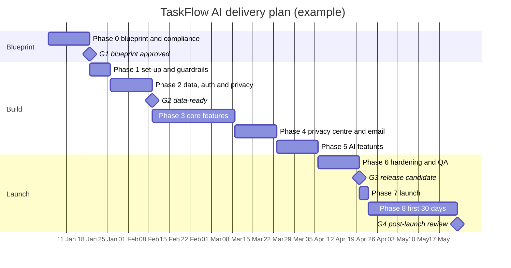

<a id="p11"></a>
## Part 11 — Delivery plan, quality & operations `[CORE]`

### 11.1 Phased implementation plan

Each phase ends with exit criteria. Don't start the next phase until they're met. Run the phases with the method chosen in 11.7; Appendix E shows where they fall in each method.

**Phase 0 — Blueprint & compliance foundations** (no production code)
- 0.1 Complete Parts 0–10 for everything in scope, and run the DPIA screening.
- 0.2 Draft the RoPA (9.3), choose vendors, sign their DPAs and fill the register (3.6).
- 0.3 Decide the age position (9.12). Draft the privacy and cookie notices from the RoPA.
- 0.4 Write the threat model (7.3) and accept the ADRs.
- **Exit → G1.**

**Phase 1 — Project initialisation & guardrails**
- 1.1 Create the repo: Next.js + TypeScript strict + Tailwind + ESLint/Prettier, using the folder structure in 3.5.
- 1.2 CI pipeline: typecheck → lint → unit tests → build → secret scan → dependency audit → Playwright smoke → **privacy test (9.9)** → axe on key pages.
- 1.3 Security headers and CSP (report-only first); fonts through `next/font`; error monitoring with PII scrubbing.
- 1.4 Separate Supabase projects per environment, with synthetic seed data (3.2).
- **Exit:** green pipeline on the empty app; zero third-party requests; CSP report clean.

**Phase 2 — Data layer, auth & privacy plumbing**
- 2.1 Prisma schema and migrations (5.3). RLS policies plus **tenant-isolation tests** (5.4).
- 2.2 Auth (Google OAuth + magic link), protected layouts, silent refresh, and states S7/S8.
- 2.3 Sign-up with the age check and consent capture (`consent_records`). Terms acceptance is recorded separately.
- 2.4 `assertCan()` data-access layer, the permission-matrix test (7.2) and the audit log.
- **Exit → G2 in staging:** privacy notice live, consents recorded, RLS and permission tests green.

**Phase 3 — Core features with full state coverage**
- 3.1 Server Actions for task CRUD, with Zod validation, authorisation and optimistic updates (S9, S10).
- 3.2 Board UI with S1–S6, S11 and S15, plus the keyboard and "Move to…" alternative to dragging (2.5.7).
- 3.3 Task detail and real-time comments with sanitised Markdown and conflict handling (S12).
- **Exit:** state matrix complete for these screens; E2E tests green.

**Phase 4 — Privacy centre, consent & communications**
- 4.1 Cookie banner, cookie settings, consent-gated loader and the published cookie register (9.8).
- 4.2 Privacy centre: download my data, delete account (30-day grace), consents, marketing preferences, complaint form.
- 4.3 Email:
  - transactional templates;
  - a marketing stream with one-click unsubscribe headers and the suppression list;
  - double opt-in where needed (9.11).
- 4.4 Admin rights-request queue with due dates and templates (9.15–9.16).
- **Exit:** export, deletion and unsubscribe E2E tests pass; email headers verified in a seed inbox.

**Phase 5 — AI features** `[IF: AI]`
- 5.1 Provider integration under ADR-006: DPA, region and no training confirmed; redaction in place.
- 5.2 Structured outputs validated with Zod; S14 with Cancel; AI labels; S13 for quotas.
- 5.3 Eval suite in CI, spend caps and alerts, and a feature flag (S15).
- **Exit:** evals at or above thresholds; a spend-alert test fired.

**Phase 6 — Hardening & QA**
- 6.1 Accessibility audit: axe, keyboard-only, VoiceOver/NVDA (10.6).
- 6.2 Performance budgets in Lighthouse CI (NFR-PERF); load test of critical paths.
- 6.3 DAST (ZAP baseline), dependency review, secret-rotation check, and a pen test for the High tier.
- 6.4 Backup restore drill and a breach tabletop exercise.
- **Exit:** no open critical or high issues.

**Phase 7 — Launch**
- 7.1 Every item in the **Launch gate (Part 13)** is green. Regulator admin done: ICO fee, NDPC if you're a DCPMI, EU representative if needed.
- 7.2 Deploy to production behind feature flags. Dashboards, alerts and the status page go live.
- **Exit → G3.**

**Phase 8 — First 30 days**
- 8.1 Daily review of errors, performance, AI cost and feedback. Triage weekly.
- 8.2 Hold the G4 review and start the compliance calendar (9.24).

### 11.2 Definition of Ready & Definition of Done

**Ready (per story):**
- [ ] The story has an `FR` ID and acceptance criteria (1.6).
- [ ] Applicable UI states are listed.
- [ ] Data fields are mapped in the dictionary (5.2).
- [ ] The API is defined (6.2).
- [ ] Privacy impact is noted: new data? new vendor? consent needed?
- [ ] The design exists, if there's UI.
- [ ] Prior art is checked for anything new: how others built it and the problems they hit (12.2, step 0).
- [ ] The test approach is agreed.

**Done (per story):**
- [ ] Code + tests pass in CI.
- [ ] **All applicable UI states** are implemented and tested.
- [ ] Input is validated on the server, and authorisation is enforced and tested.
- [ ] No personal data in logs.
- [ ] **No new third-party requests**, or the service is registered (3.6), consent-gated and allowed in the CSP.
- [ ] axe is clean and the keyboard path works.
- [ ] Docs are updated: blueprint IDs; an ADR if you deviated; the RoPA, data dictionary, cookie register and privacy notice if data changed.
- [ ] Self-review checklist done (12.2), smoke-tested in preview, behind a flag if risky.

### 11.3 Testing strategy

| Level | Tool | Covers | Runs |
|---|---|---|---|
| Static | TypeScript strict, ESLint (+ `jsx-a11y`), Prettier | Types, lint, accessibility lint | Every commit |
| Unit | Vitest | Domain logic, Zod schemas, `assertCan()`, the permission matrix | Every PR |
| Integration | Vitest + local Supabase (Docker) | Server Actions, **RLS as anon / member / other tenant** (5.4), migrations | Every PR |
| End-to-end | Playwright | Critical journeys: sign-up with age check, consent banner, export and delete, invite, standup. **State coverage:** offline with `context.setOffline(true)`, slow with a delayed `page.route`, 401/403/429/500 mocks. | Smoke per PR, full nightly |
| Privacy | Playwright | No third-party requests before consent or after rejection (9.9); consent enforced; email headers | Every PR |
| Accessibility | @axe-core/playwright + manual | WCAG 2.2 AA (10.6) | PR (automated), each release (manual) |
| Performance | Lighthouse CI, k6 | NFR-PERF budgets, load | PR (Lighthouse), before launch (k6) |
| Security | gitleaks, `npm audit`/Renovate, CodeQL or Semgrep, OWASP ZAP | 7.4 | PR; ZAP before launch |
| AI evals | Custom runner | 8.5 | When the prompt or model changes |

- **Test data:** synthetic only, with fixtures per role and two tenants.
- **Coverage target:** ≥ {{80%}} on domain logic. Coverage is a signal, not the goal.

### 11.4 CI/CD & release management

- **Branching:** trunk-based, short-lived branches; PRs are small and reference blueprint IDs.
- **Preview deployments** use synthetic data and are behind deployment protection.
- **Migrations:** `prisma migrate deploy` runs in the release step. Changes are backwards-compatible, using expand → migrate → contract (5.5).
- **Feature flags** for risky features. Releases use semantic versioning with a changelog.
- **Rollback:** redeploy the previous build and fix the database forwards. Practise it once before launch.

**PR template** (`.github/pull_request_template.md`):

```markdown
## What & why
FR/ADR/SCR IDs:

## Checklist
- [ ] UI states covered (list): 
- [ ] Server-side validation + authorisation re-checked in every action/route touched
- [ ] Tests added/updated and passing (unit / integration / e2e)
- [ ] No new third-party requests, or: registered (3.6), consent-gated, CSP updated
- [ ] No personal data in logs, analytics, error events or AI prompts
- [ ] Data changes reflected in data dictionary / RoPA / privacy notice / cookie register
- [ ] Accessibility: keyboard path + axe clean
```

### 11.5 Observability & operations

- **SLOs:** availability {{99.5%}}; p95 latency (NFR-PERF-02); error rate < {{1%}}. Alert on burn rate, not on single errors.
- **Signals:** structured logs with correlation IDs, error monitoring, uptime checks on the key routes and API, cost dashboards (infrastructure and AI).
- **On-call:** even if you're solo, route alerts to your phone and keep a phone-friendly runbook.
- **Runbooks** (`docs/runbooks/`):
  - deploy and rollback;
  - rotate keys;
  - restore the database (5.7);
  - AI provider outage (turn the flag off);
  - email deliverability problem;
  - breach response (9.20).
- **Status page** for customer-facing incidents.

### 11.6 Incident response

| Severity | Example | Respond within | Communicate |
|---|---|---|---|
| SEV1 | Outage, data breach, security incident | 15 min | Status page; customers; regulators if it's a breach (9.20) |
| SEV2 | Core feature broken for many users | 1 h | Status page |
| SEV3 | Minor bug, workaround exists | Next working day | Changelog |

Run a blameless post-incident review within 5 working days (Appendix A7), and track its actions to completion.

### 11.7 Choosing a delivery method

Bansat's phases (11.1) and gates (G0–G4) work with any method. The gates say what must be true before you move on; the method says how the team works in between. Choose it from the delivery questions (0.4):
- **Read each answer on its own** instead of adding up a score, because one strong factor can decide. The PRINCE2 Agile® Agilometer works the same way.
- **Record the choice and the reason in an ADR** (4.1).
- **Revisit it at G4**, or when the answers change.

**Hybrid by default.** Bansat is already a hybrid: the blueprint is agreed up front, to G1, and the build after it is iterative. Most projects then use Scrum or Kanban for the build.

| If the answers say | Use | Why |
|---|---|---|
| D8 names a method the organisation uses | That method, with Bansat's gates mapped onto it | Your project's rules win (How to use, item 7) |
| D5 is a fixed-price client, D4 fixes both the date and the scope, or D6 is yes | Stage gates (E3), with iterative builds inside each stage | The client or auditor approves stages, and G0–G4 already are stage boundaries |
| D2 is two or more teams on one product | A scaled method (E6): one backlog, one Product Owner, one Definition of Done | Several teams need one view of the product; start with as little structure as possible |
| D1 is one person | The solo loop (E5) | There are no team events to run alone, but the gates still apply |
| D7 is mostly a stream of requests and fixes, or the project is a live retrofit (Part 14) | Kanban (E2) | Flow suits work that arrives unpredictably, and the gap register becomes the board |
| D3 is still being discovered, with one team of two to nine | Scrum (E1) | Short Sprints and reviews suit complex work where you learn by building |
| A product team sets its own appetite, has no client deadline, and D3 is mostly known | Shape Up (E4) | Fixed time and variable scope, with shaping done up front |

Work down the table and take the first row that applies. When two rows apply, combine them: the outer method handles approvals with the client or organisation (usually E3), and the inner one runs the build (E1, E2 or E5). For example, a freelancer on a fixed-price contract uses stage gates with the client and the solo loop inside each stage.

### 11.8 Project-management toolkit

Each tool comes with the way it usually goes wrong. Keep them in the repo next to the blueprint (`docs/`), so they change in the same pull requests.

**RACI** (who does what). One row per decision or deliverable, one column per role. Every row has at least one **R** (does the work) and exactly one **A** (answers for it, and signs it off). **C** is consulted before (two-way); **I** is informed after (one-way). A gate's **A** is always a named person (Document control).

| Decision or deliverable | Owner | Developer | Designer | Client | DPO / privacy lead |
|---|---|---|---|---|---|
| Sign G1 (blueprint approved) | A | C | C | C | C |
| Privacy notice (9.6) | A | C | I | C | R |
| Release to production (G3) | A | R | I | C | C |
| {{ }} | | | | | |

*How it goes wrong:* several A's on one row, so nobody decides; or a RACI written once and never updated.

**RAID log** (risks, assumptions, issues, dependencies). One row per item, with an ID, description, owner, priority, status, target date and next step. Risks add likelihood and impact. Assumptions link to 1.9, risks to 7.3 and 8.4, and decisions go to an ADR, not here.

| ID | Type | Description | Owner | Likelihood · Impact | Status | Next step · Date |
|---|---|---|---|---|---|---|
| RISK-01 | Risk | The AI provider changes its data-retention terms | {{ }} | Low · High | Open | Review the DPA quarterly (9.18) · {{date}} |
| DEP-01 | Dependency | The client supplies brand assets for the design brief (10.5) | {{ }} | — | Waiting | Chase on {{date}} |

*How it goes wrong:* a log that grows but is never reviewed. Go through it at every planning session and every gate.

**Stakeholder map** (power and interest). Place each stakeholder by how much they can affect the project and how much they care about it:
- High power, high interest: **manage closely**.
- High power, low interest: **keep satisfied**.
- Low power, high interest: **keep informed**.
- Low power, low interest: **monitor**.

Users and the people whose data you process belong on the map too. It's a snapshot, so redraw it at each gate.

**Status report** (weekly or per Sprint, one page):

```text
Project: {{ }}    Period: {{ }}    Working towards: G{{n}} (see Gate approvals)
Overall: Green | Amber | Red, with one sentence of evidence
Scope · Schedule · Budget · Quality and risk: a colour each, with the evidence (tests, flow measures, open blockers)
Done since the last report: {{FR IDs}}          Next: {{FR IDs}}
Decisions needed, from whom and by when: {{ }}
Top 3 RAID items: {{IDs}}
```

*How it goes wrong:* the "watermelon" report, green on the outside and red inside. Every colour needs evidence, amber is information rather than failure, and the honest headline is always which gate you're working towards and what's left for it.

**Change request** (anything that changes scope, time, cost, quality, risk, or privacy and security):

```text
CR-NNN — {{title}}                 Raised by: {{ }}   Date: {{ }}
Type: request for change | off-specification (something doesn't meet its spec) | problem or concern
What and why: {{ }}
Impact: time {{ }} · cost {{ }} · scope {{ }} · quality {{ }} · risk {{ }} · privacy and security {{new data? new vendor? (9.3, 3.6)}}
Blueprint IDs affected: {{FR-, SCR-, DATA-, ADR-}}
Decision: approve | defer | reject      By: {{the A in the RACI}}     Date: {{ }}
```

Capture it, assess the impact, recommend, decide, then implement, updating the blueprint in the same pull request as the change. *How it goes wrong:* changes absorbed quietly ("it's only small"), which is how fixed-price projects lose money.

**Timeline.** A Mermaid gantt chart lives in Markdown and renders on GitHub. Mark the gates as milestones, and treat the dates as a forecast to update, not a promise:



*How it goes wrong:* false precision. A chart planned to the day months ahead hides the uncertainty, so keep it at the phase level and forecast the detail.

**Estimation and forecasting.**
- **Forecast from throughput:** count the items finished each week, then run a Monte Carlo simulation to give a date with a probability, for example "85% likely to finish the remaining 30 items by 12 March".
- **Make the forecast trustworthy:** it needs a reasonably stable way of working and an honest record that includes weeks where nothing finished.
- **Story points, if you use them:** keep them inside one team for its own planning. Never set them as a target, and never compare teams with them; once velocity becomes a target, it stops measuring anything.
- **Fixed-price quotes:** give a range, list the assumptions behind it in the RAID log, and put a change-request process in the contract.
